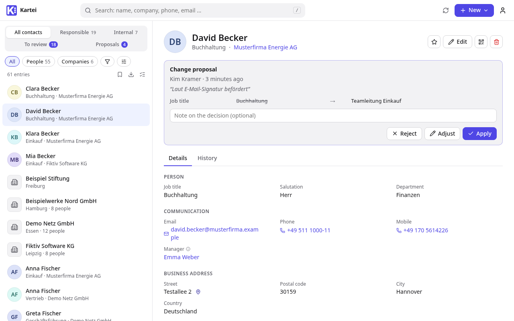

# Kartei

Kartei is a contact directory for persons and companies. It suits organizations that want one well-kept source of contact data for people, phones, email clients and other systems.

**Manuals online:** [undone37.github.io/Kartei](https://undone37.github.io/Kartei/) (English and German)



- **Your own fields:** admins define the fields: types, options, validation, visibility per role and vCard mapping. Field sets and import mappings are plain JSON files.
- **Fast:**
  - the whole visible directory is held in the browser
  - search covers names, companies, phone numbers in any format and all searchable fields
  - an advanced filter with nested AND/OR/NOT groups, saved filters, favorites, list export and bulk edit
- **Kept up to date:** every contact has a responsible colleague who reviews it regularly, with emailed reminders. Read-only users propose changes or deletions, and maintainers apply, adjust or reject them. Every change is audited, and deleted contacts go to a recycle bin.
- **Data quality:** duplicates are detected and merged, phone numbers are normalized, and a data-quality page lists what needs attention.
- **Distribution:**
  - contacts on iPhone and Android through the Outlook app (Microsoft Graph sync into each Exchange Online mailbox)
  - read-only CardDAV for phones without a mailbox, optionally through a relay in the DMZ
  - AD contact objects
  - configurable CSV/XLSX exports
  - a REST API with tokens (read only, or read and write)
- **Sign-in:** single sign-on with any OpenID Connect provider and SCIM provisioning (Entra ID, Okta, Authentik, …), LDAP/Active Directory with role groups, plus local accounts.
- **Email:** via SMTP or Microsoft 365 (OAuth2), with editable texts.
- **Operations:** daily database backups with a restore test, health and status endpoints for monitoring systems (Checkmk, Zabbix, PRTG), sign-ins and changes in the audit log, sent to your SIEM via syslog.
- **Interface:** German and English, light and dark theme, and it can be installed as an app (PWA).

## Documentation

| | English | Deutsch |
|---|---|---|
| User manual (Read only, Maintainer) | [online](https://undone37.github.io/Kartei/en/user.html) · [source](manuals/en/user.md) | [online](https://undone37.github.io/Kartei/de/user.html) · [Quelle](manuals/de/user.md) |
| Administrator manual | [online](https://undone37.github.io/Kartei/en/admin.html) · [source](manuals/en/admin.md) | [online](https://undone37.github.io/Kartei/de/admin.html) · [Quelle](manuals/de/admin.md) |
| REST API (read and write, for other systems) | [docs/API.md](docs/API.md), [docs/openapi.yaml](docs/openapi.yaml) | |
| Architecture | [docs/ARCHITECTURE.md](docs/ARCHITECTURE.md) | |

Every [release](https://github.com/undone37/Kartei/releases) also has the manuals attached as PDF.

## Quick start with Docker

```sh
cp .env.example .env        # set SECRET_KEY, POSTGRES_PASSWORD, ADMIN_USERNAME/ADMIN_PASSWORD, hosts, EXPORT_HOST_DIR
docker compose up -d --build
```

Instead of building, you can use the released images: set `KARTEI_IMAGE=ghcr.io/undone37/kartei:0.6.0-beta` in `.env`, then `docker compose pull && docker compose up -d --no-build` (relay: `RELAY_IMAGE=ghcr.io/undone37/kartei-relay:0.6.0-beta`). For testing the current state of `main`, there are nightly images: `ghcr.io/undone37/kartei:nightly` (and `kartei-relay:nightly`), built every night when `main` has changed, plus `:sha-<commit>` per build. They are not releases; don't use them in production.

To use a dedicated PostgreSQL server or cluster instead of the bundled database container, set `DATABASE_URL` and use `compose.external-db.yaml`; the administrator manual (Installation) has the details.

Kartei listens on port 8000; put a TLS reverse proxy in front of it. On the first start it creates the database, a few starter fields (`examples/fields-default.json`) and the admin account from `.env`. Everything else is configured in the browser under *Settings*: the [administrator manual](https://undone37.github.io/Kartei/en/admin.html) walks through it, including backups, monitoring and forwarding logs to a SIEM (`compose.logging.yaml`).

### Try it with sample data

Seed an empty installation:

```sh
docker compose exec web python manage.py seed_demo --password demo12345
```

This loads the example field set and creates fictional companies and persons, demo users (`mmuster`, `tbauer`: Maintainer; `kkramer`, `lschmidt`: Read only), open reviews, proposals, saved filters, sample exports and a few data-quality cases. It refuses to run if contacts already exist.

### Optional: CardDAV relay in the DMZ

If phones must not reach the internal network, a small read-only CardDAV relay runs on a separate host in the DMZ. Kartei pushes the rendered vCards and the CardDAV login (username and password hash) to it over HTTPS; the relay never opens a connection and holds nothing else. On the DMZ host:

```sh
cp .env.relay.example .env.relay   # SECRET_KEY, ALLOWED_HOSTS, RELAY_PUSH_TOKEN_SHA256 (shown in Kartei → Settings → CardDAV)
docker compose -f compose.relay.yaml up -d --build   # port 8080, own SQLite volume, no frontend build
```

Then enter the relay URL in Kartei under *Settings → CardDAV*. The administrator manual (CardDAV chapter) has the firewall rule, TLS and troubleshooting.

## Keyboard shortcuts

| Key | Action |
|---|---|
| `/` | search |
| `↑` `↓` | move through results |
| `Enter` | open the first or selected result |
| `E` | edit |
| `N` / `Shift+N` | new person / company |
| `Ctrl+S` | save |
| `Esc` | cancel |

## Contributing and license

Contributions are welcome – see [CONTRIBUTING.md](CONTRIBUTING.md) (development setup, tests, releases) and the [code of conduct](CODE_OF_CONDUCT.md); changes are listed in the [changelog](CHANGELOG.md). Kartei is free software under the [GNU Affero General Public License v3.0](LICENSE): if you run a modified version for others over a network, you must offer them its source code.
