# Benutzerhandbuch

Kartei ist ein Adressbuch für Personen und Firmen. Je nachdem, wie deine Organisation es eingerichtet hat, erscheinen die Kontakte, die du hier pflegst, auch auf Telefonen, in Outlook, in der Anruferkennung und in Exporten für andere Systeme. Dieses Handbuch beschreibt die tägliche Arbeit mit Kartei für die beiden Rollen ohne Administrationsrechte:

| | Nur Lesen | Bearbeiter |
|---|:---:|:---:|
| Kontakte ansehen, suchen und filtern, vCards herunterladen | ✓ | ✓ |
| Listen exportieren (Excel, CSV), Filter speichern, Favoriten setzen | ✓ | ✓ |
| Eigene Prüfungen bestätigen (*Alles korrekt*) | ✓ | ✓ |
| Änderungen und Löschungen vorschlagen | ✓ | – |
| Neue Personen und Firmen vorschlagen | ✓ | – |
| Eigene offene Vorschläge in der Liste *Vorschläge* sehen | ✓ | – |
| Kontakte anlegen, bearbeiten und löschen, mehrere auf einmal bearbeiten | – | ✓ |
| Kontakte aus dem Papierkorb wiederherstellen | – | ✓ |
| Vorschläge übernehmen, anpassen oder ablehnen | – | ✓ |
| Datenqualität, Dubletten zusammenführen, letzte Änderungen | – | ✓ |

Abschnitte, die nur für die Rolle *Bearbeiter* gelten, sind mit **Bearbeiter** gekennzeichnet. Felder, Benutzer, Exporte und die Telefon-Synchronisation richtet die Administration ein; das steht im Administrationshandbuch. Die Feldnamen in diesem Handbuch stammen aus dem Standard-Feldsatz – bei dir können sie anders heißen.

## Erste Schritte

### Anmelden

Öffne die Kartei-Adresse, die du von der IT bekommen hast, und melde dich mit **Benutzername** und **Passwort** an. Je nach Einrichtung deiner Organisation sind das deine üblichen Netzwerk-Zugangsdaten (z. B. von Windows) oder ein eigenes Kartei-Konto. Mit den Knöpfen unter dem Formular wechselst du zwischen *Deutsch* und *English*.

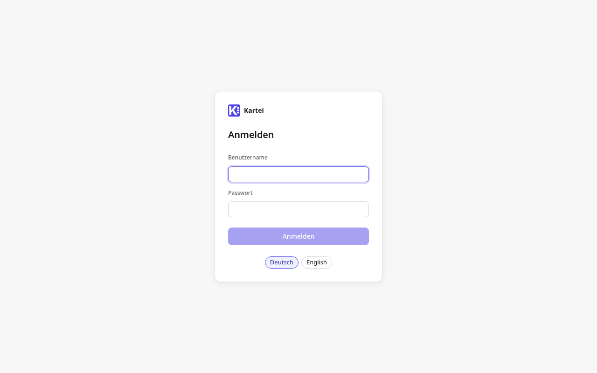

Nach zu vielen falschen Passwörtern sperrt Kartei weitere Versuche für 15 Minuten (*Zu viele Versuche – bitte 15 Minuten warten*). Zum Abmelden wählst du **Abmelden** im Benutzermenü.

### Als App installieren

Du kannst Kartei als App installieren. Sie öffnet sich dann in einem eigenen Fenster und startet nach der ersten Synchronisation auch ohne Netzverbindung.

- **Computer (Chrome oder Edge):** auf das Installieren-Symbol rechts in der Adressleiste klicken oder im Browsermenü *Installieren* wählen.
- **iPhone:** Kartei in Safari öffnen, auf *Teilen* tippen, dann *Zum Home-Bildschirm*.
- **Android:** Kartei in Chrome öffnen und im Browsermenü *Zum Startbildschirm hinzufügen* bzw. *App installieren* wählen.

Ohne Verbindung erscheint oben rechts ein durchgestrichenes WLAN-Symbol (*Offline – zeige zwischengespeicherte Daten*). Suchen und Lesen funktioniert weiter, zum Speichern brauchst du aber eine Verbindung.

### Sprache und Darstellung

Ein Klick auf das Personen-Symbol oben rechts öffnet das **Benutzermenü**. Dort siehst du deinen Namen und deine Rolle und kannst einstellen:

- die Sprache: **Deutsch** oder **English**
- die **Darstellung**: **System** (wie dein Rechner eingestellt ist), **Hell** oder **Dunkel**. Das gilt jeweils nur für das Gerät, auf dem du es einstellst.

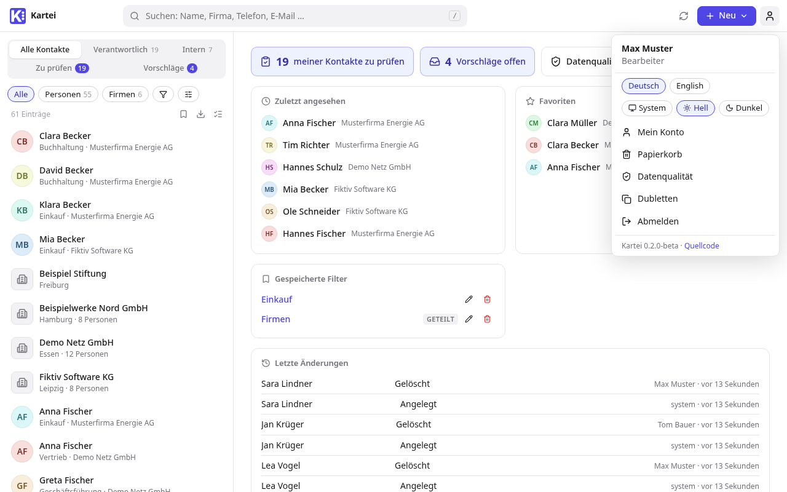

Unter **Mein Konto** kannst du die Sprache ebenfalls wählen (*Standard (…)* nimmt die Standardsprache eurer Installation) und, wenn du ein lokales Konto hast, dein Passwort ändern (*Neues Passwort (min. 10 Zeichen)*). Meldest du dich mit deinem Netzwerk-Konto an, änderst du das Passwort dort (*Dein Passwort wird im Active Directory verwaltet.*).

Ganz unten zeigt das Benutzermenü die Kartei-Version (hilfreich bei Fehlermeldungen) und einen Link zum **Quellcode**.

Der Screenshot zeigt das Menü eines Bearbeiters. Mit der Rolle *Nur Lesen* fehlen **Papierkorb**, **Datenqualität** und **Dubletten**; die Administration sieht zusätzlich **Einstellungen**.

### Der Bildschirmaufbau

- **Oben:** Suchfeld, der Knopf **Jetzt synchronisieren**, für Bearbeiter der Knopf **Neu**, und das Benutzermenü.
- **Links:** die Kontaktliste mit Listenumschalter, Filtern und Listenwerkzeugen.
- **Rechts:** der ausgewählte Kontakt oder, wenn keiner ausgewählt ist, deine Startseite.

Kartei aktualisiert sich alle 30 Sekunden von selbst und jedes Mal, wenn du ins Fenster zurückkehrst. Mit **Jetzt synchronisieren** holst du Änderungen sofort.

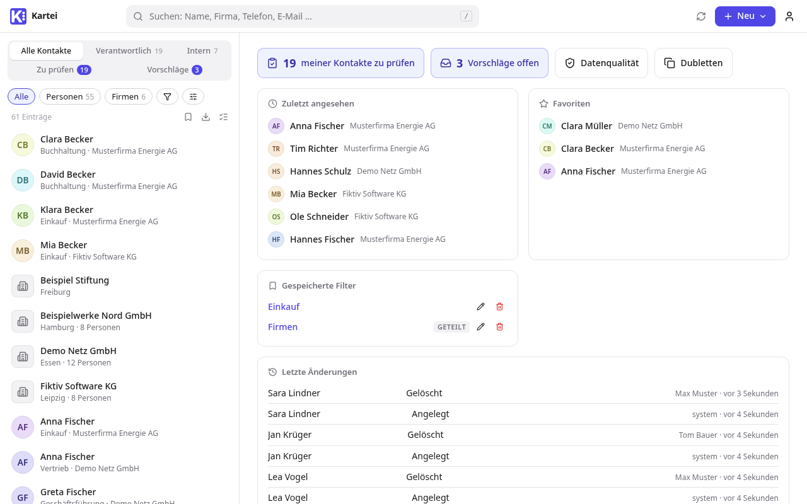

Auf dem Handy zeigt Kartei entweder die Liste oder den Kontakt. Mit dem Pfeil oben links im Kontakt kommst du zurück zur Liste.

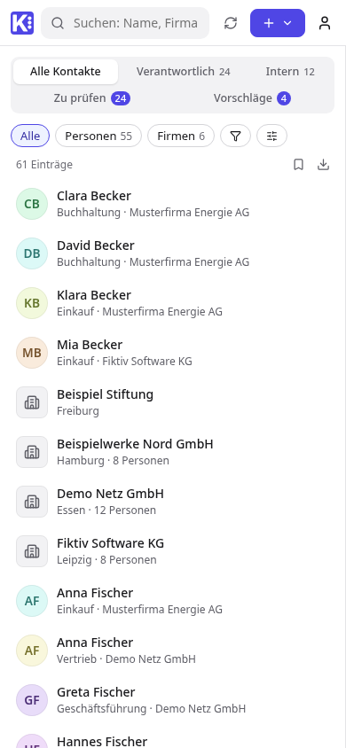{: width="320"} 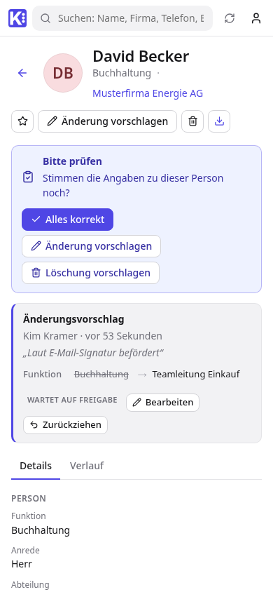{: width="320"}

## Kontakte finden

### Suche

Klick ins Suchfeld oder drück <kbd>/</kbd> und tipp los. Die Liste filtert sich während der Eingabe. Gesucht wird in Namen, Firmen, Telefonnummern, E-Mail-Adressen und allen anderen durchsuchbaren Feldern.

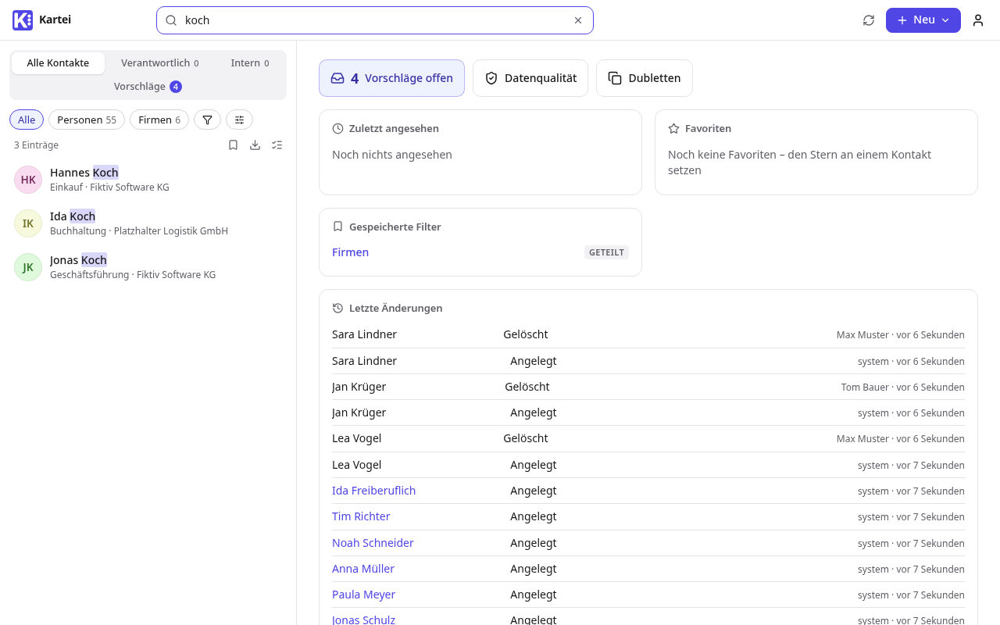

- **Mehrere Wörter** müssen alle passen: `meier lübeck` findet Meier in Lübeck.
- **Groß-/Kleinschreibung und Umlaute** spielen keine Rolle: `lubeck`, `luebeck` und `Lübeck` finden alle Lübeck.
- **Telefonnummern** findest du in jeder Schreibweise: `0511 1000-12`, `+49 511 100012` und `051110001` finden dieselbe Nummer. Ein Teil reicht, zum Beispiel nur die Durchwahl.
- Auch der Firmenname einer Person wird durchsucht: `musterfirma` zeigt die Firma *Musterfirma Energie AG* und ihre Mitarbeiter.

Mit <kbd>Enter</kbd> öffnest du den ersten Treffer, mit <kbd>↑</kbd> <kbd>↓</kbd> blätterst du durch die Treffer. <kbd>Esc</kbd> leert die Suche, ein zweites <kbd>Esc</kbd> verlässt das Suchfeld.

### Listen

Der Umschalter über der Liste bestimmt, welche Kontakte du siehst. Neben jeder Liste steht, wie viele Kontakte sie enthält.

| Liste | Zeigt |
|---|---|
| **Alle Kontakte** | alle Personen und Firmen |
| **Verantwortlich** | Kontakte, für die du verantwortlich bist (du bist ihr *Ansprechpartner intern*) |
| **Intern** | Kontakte, bei denen du unter *Kontakte intern* eingetragen bist |
| **Zu prüfen** | Kontakte, die du prüfen sollst (nur solange du offene Prüfungen hast) |
| **Vorschläge** | Kontakte mit offenen Änderungs- oder Löschvorschlägen: für Bearbeiter alle, mit *Nur Lesen* deine eigenen (nur solange es welche gibt) |

Kartei merkt sich die zuletzt gewählte Liste.

### Personen oder Firmen

Die Knöpfe unter dem Listenumschalter grenzen weiter ein: **Alle**, **Personen** oder **Firmen**. Die Zahlen zeigen, wie viele davon in der aktuellen Liste sind.

### Feldfilter

Der Trichter-Knopf neben **Firmen** (**Feldfilter**) öffnet die Feldfilter. Er bietet die Felder an, die deine Administration für den Schnellfilter ausgewählt hat, zum Beispiel *Schlagworte*, *Ansprechpartner intern* und *Kontakte intern*. Pro Feld wählst du einen oder mehrere Werte: Ein Kontakt passt, wenn er einen der gewählten Werte hat – und zwar in jedem Feld, in dem du etwas ausgewählt hast.

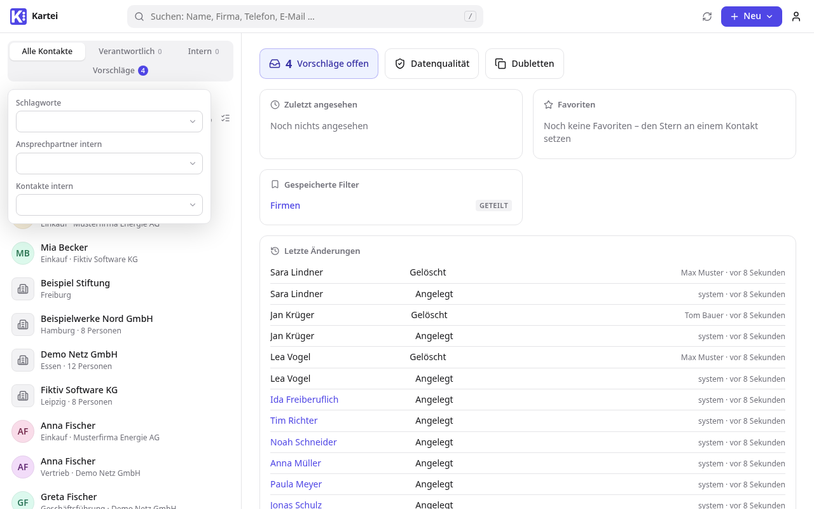

Aktive Filter erscheinen als kleine Schildchen unter den Knöpfen. Das **×** am Schildchen entfernt diesen Filter, **Filter zurücksetzen** im Filtermenü entfernt alle.

### Erweiterter Filter

Für Fragen, die die Feldfilter nicht beantworten – etwa „Personen in Hannover, die noch nie geprüft wurden“ oder „Kontakte, die in den letzten 30 Tagen geändert wurden“ –, gibt es den **Erweiterten Filter**: den Knopf mit den Schiebereglern neben dem Trichter.

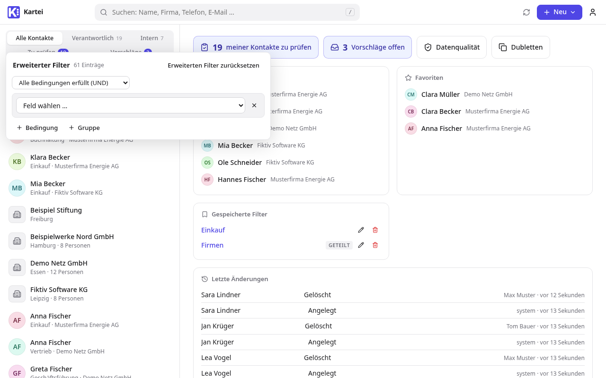

1. Klick auf den Schieberegler-Knopf. Oben steht, wie viele Kontakte gerade passen.
2. Klick auf **Bedingung** (mit dem Plus) und wähle unter **Feld wählen …** ein Feld. Neben allen Kontaktfeldern (**Felder**) gibt es **Stammdaten** wie *Art (Person/Firma)*, *Firma (Verknüpfung)*, *Angelegt am*, *Geändert am*, *Geprüft am* oder *Geändert von*.
3. Wähle den Vergleich und gib den Wert ein. Welche Vergleiche es gibt, hängt von der Art des Felds ab:
   - **Text:** *enthält*, *enthält nicht*, *ist gleich*, *ist nicht gleich*, *beginnt mit*. Wie bei der Suche spielen Groß-/Kleinschreibung und Umlaute keine Rolle, Telefonnummern werden nach ihren Ziffern verglichen.
   - **Zahlen:** *ist gleich*, *ist nicht gleich*, *kleiner als (<)*, *höchstens (≤)*, *größer als (>)*, *mindestens (≥)*, *zwischen*.
   - **Datum:** *ist am*, *vor*, *nach*, *zwischen*, *in den letzten … Tagen*, *länger her als … Tage* und ähnliche.
   - **Auswahl- und Benutzerfelder:** *ist eins von*, *ist keins von*; bei Feldern mit mehreren Werten auch *enthält eins von*, *enthält alle von*, *enthält keins von*.
   - **Ja/Nein-Felder:** *ist angehakt*, *ist nicht angehakt*.
   - Alle Felder (außer Ja/Nein): *ist leer*, *ist nicht leer*.
4. Füg bei Bedarf weitere Bedingungen hinzu. Die Auswahl oben legt fest, wie sie verknüpft werden: **Alle Bedingungen erfüllt (UND)**, **Mindestens eine erfüllt (ODER)** oder **Keine erfüllt (NICHT)**.
5. Für kompliziertere Regeln klick auf **Gruppe** (mit dem Plus): Eine Gruppe hat ihre eigene Verknüpfung und eigene Bedingungen. Gruppen lassen sich bis zu drei Ebenen tief verschachteln.

Unvollständige Bedingungen (ohne Feld oder Wert) werden ignoriert. Der erweiterte Filter wirkt zusätzlich zu Suche, Liste, *Personen*/*Firmen* und Feldfiltern. Solange er aktiv ist, steht unter den Knöpfen ein Schildchen **Erweitert: … Bedingungen** – ein Klick darauf öffnet den Filter wieder, das **×** entfernt ihn. **Erweiterten Filter zurücksetzen** löscht alle Bedingungen.

> Beispiel „Personen, deren Prüfung überfällig ist oder die noch nie geprüft wurden“: oben *Alle Bedingungen erfüllt (UND)*, Bedingung *Art (Person/Firma)* *ist eins von* *Person*, dazu eine Gruppe mit *Mindestens eine erfüllt (ODER)* und den Bedingungen *Geprüft am* *ist leer* sowie *Geprüft am* *länger her als … Tage* 365.
{: .tip}

### Gespeicherte Filter

Brauchst du dieselbe Liste öfter, speicher sie. Ein gespeicherter Filter merkt sich Suchtext, Liste, Personen/Firmen-Auswahl, Feldfilter und den erweiterten Filter.

1. Stell die Liste so ein, wie du sie haben willst.
2. Klick auf das Lesezeichen-Symbol über der Liste.
3. Gib unter **Aktuelle Liste speichern als …** einen Namen ein und klick auf **Speichern**.

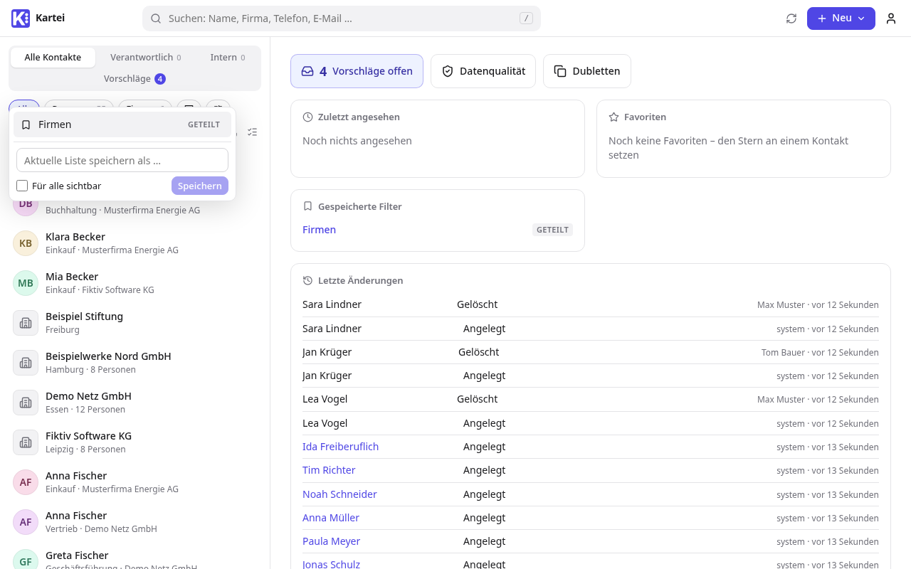

Einen gespeicherten Filter rufst du im selben Menü auf oder auf der Startseite unter **Gespeicherte Filter**. Dort kannst du deine eigenen Filter mit dem Stift umbenennen und mit dem Papierkorb nach einer Rückfrage löschen (ein geteilter Filter verschwindet für alle).

Als Bearbeiter kannst du beim Speichern **Für alle sichtbar** ankreuzen. Der Filter steht dann allen zur Verfügung und ist mit **Geteilt** markiert.

### Liste exportieren

Der Download-Knopf über der Liste exportiert genau die gerade angezeigten Kontakte (mit allen Filtern) in derselben Reihenfolge, wahlweise als **Excel (XLSX)** oder **CSV**. Die Datei enthält alle Felder, die du sehen darfst.

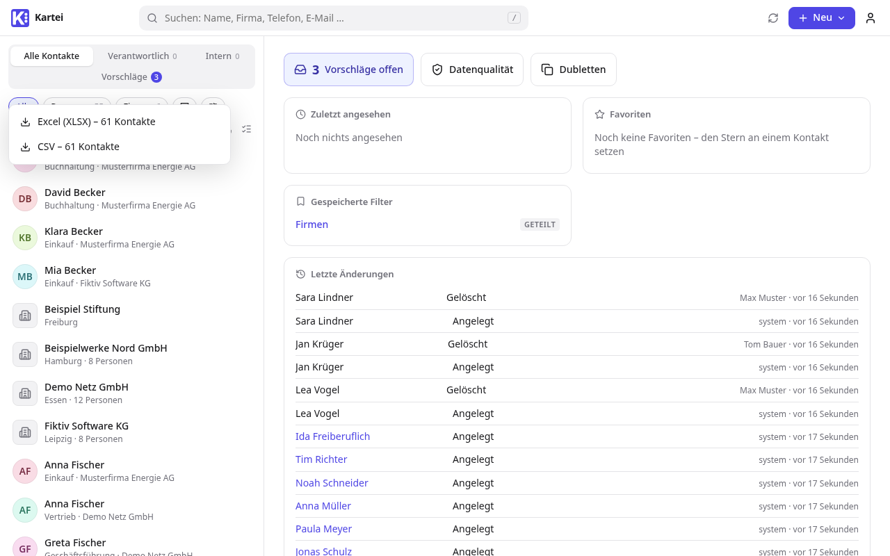

> Exporte werden im Protokoll festgehalten. Geh sorgsam mit den Dateien um – sie können personenbezogene Daten enthalten.
{: .warn}

## Die Startseite

Ist kein Kontakt ausgewählt, siehst du rechts deine Startseite:

- **… meiner Kontakte zu prüfen:** deine offenen Prüfungen. Ein Klick schaltet die Liste auf **Zu prüfen**.
- **… Vorschläge offen** (**Bearbeiter**): offene Vorschläge. Ein Klick schaltet die Liste auf **Vorschläge**.
- **Datenqualität** und **Dubletten** (**Bearbeiter**): Abkürzungen zu diesen Seiten.
- **Zuletzt angesehen:** die Kontakte, die du zuletzt geöffnet hast.
- **Favoriten:** Kontakte, die du mit dem Stern markiert hast.
- **Gespeicherte Filter:** deine eigenen und die für alle geteilten Filter.
- **Letzte Änderungen** (**Bearbeiter**): die neuesten Änderungen aller Benutzer. Fahr mit der Maus über einen Eintrag, um alte und neue Werte zu sehen.

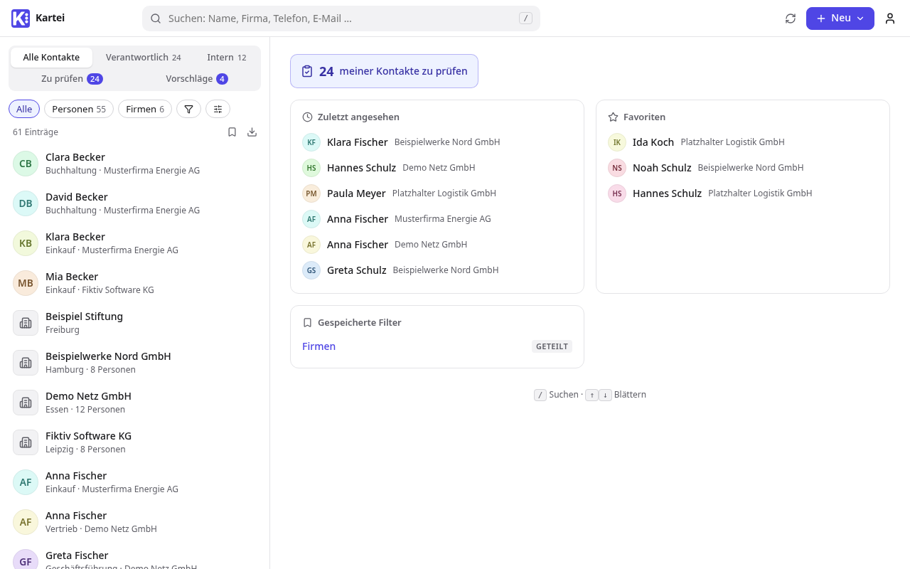

Zuletzt angesehene Kontakte und Favoriten hängen an deinem Konto – du siehst also auf jedem Gerät dieselben. Ein Klick auf das **Kartei**-Logo bringt dich jederzeit zur Startseite zurück. Bearbeiter sehen unten außerdem einen Hinweis auf die Tastenkürzel.

## Einen Kontakt ansehen

Klick in der Liste auf einen Kontakt, um ihn zu öffnen.

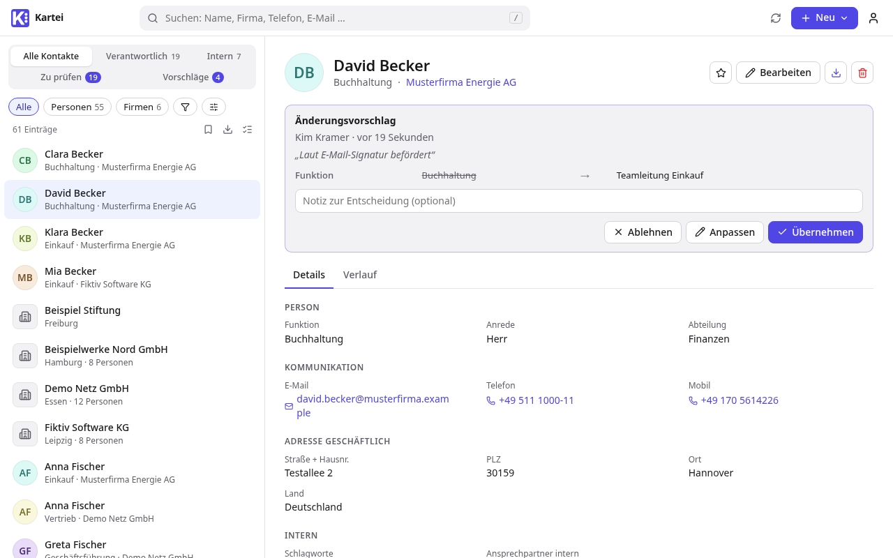

Oben stehen Name, Position und bei Personen ein Link zur Firma. Die Knöpfe rechts:

| Knopf | Macht |
|---|---|
| Stern | **Zu Favoriten hinzufügen** / **Aus Favoriten entfernen** |
| **Bearbeiten** | öffnet das Formular (**Bearbeiter**, auch <kbd>E</kbd>) |
| **Änderung vorschlagen** und Papierkorb | Änderung oder Löschung vorschlagen (Nur Lesen) |
| Download | **vCard herunterladen**, z. B. um den Kontakt in ein anderes Programm zu übernehmen |
| Roter Papierkorb | **Löschen**: verschiebt den Kontakt in den Papierkorb (**Bearbeiter**) |

### Details

Der Reiter **Details** zeigt alle ausgefüllten Felder, in Abschnitte gegliedert. Leere Felder werden ausgeblendet.

- Telefonnummern und E-Mail-Adressen sind Links: Ein Klick startet einen Anruf (z. B. über dein Softphone oder auf dem Handy) bzw. eine neue E-Mail.
- Der Kopieren-Knopf neben Telefonnummer oder E-Mail-Adresse legt sie in die Zwischenablage.
- Webseiten öffnen sich in einem neuen Tab.
- Felder mit einem kleinen **i** haben einen Hilfetext – fahr mit der Maus über das Symbol.
- Bei verknüpften Personen (z. B. *Geschäftsführer*) ist der Name ein Link zur Person.

Ganz unten steht, wann und von wem der Kontakt zuletzt geändert (*Geändert … von …*, bei automatischen Änderungen nur *Geändert …*) und geprüft wurde (*Geprüft … von …* oder *Noch nie geprüft*). Aus einem früheren System übernommene Kontakte zeigen außerdem ihre *Alt-ID*.

### Firmen und ihre Personen

Firmen haben zusätzlich den Reiter **Personen** mit allen, die dort arbeiten. Als Bearbeiter legst du über **Person bei dieser Firma anlegen** direkt einen neuen Mitarbeiter an.

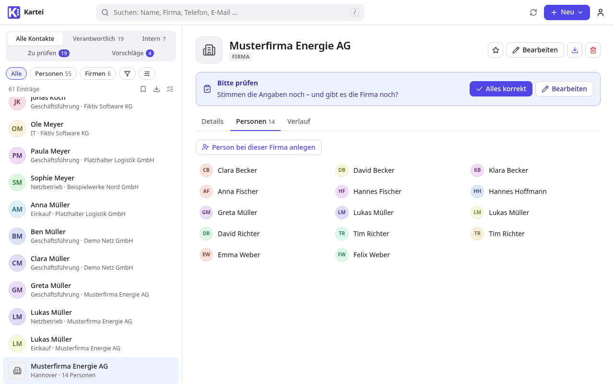

### Verlauf

Der Reiter **Verlauf** zeigt jede Änderung am Kontakt: wer wann was geändert hat, mit altem und neuem Wert. Auch Vorschläge, Prüfungen, Entscheidungen und Löschungen stehen dort.

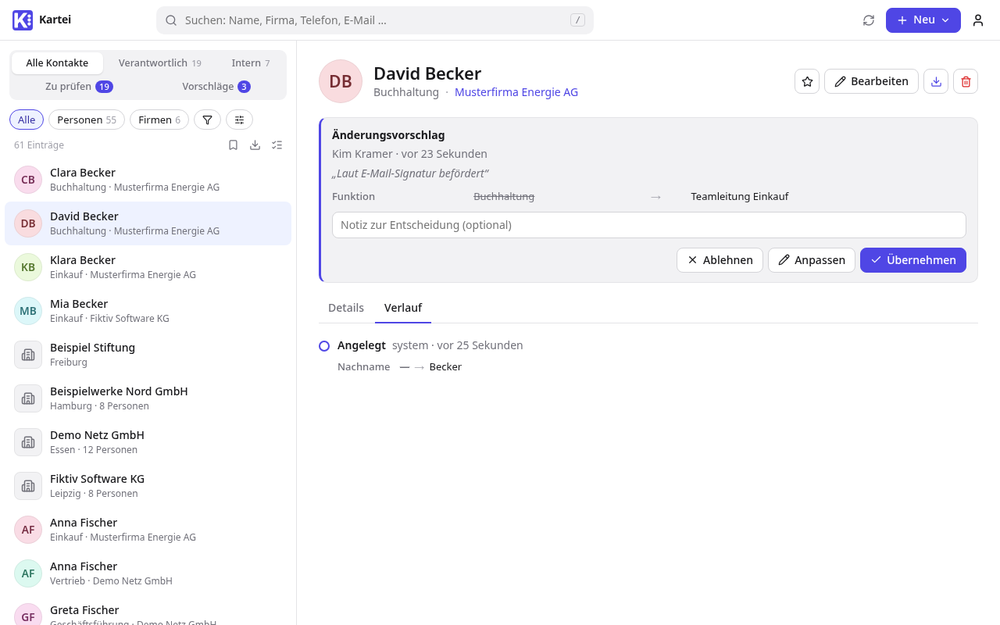

## Prüfungen

Kontaktdaten veralten: Leute wechseln die Stelle, Firmen ziehen um oder geben auf. Deshalb bittet Kartei regelmäßig die Kollegin oder den Kollegen, der für einen Kontakt verantwortlich ist (*Ansprechpartner intern*), ihn zu prüfen.

### So wirst du benachrichtigt

Sind Prüfungen fällig, bekommst du **eine E-Mail** mit einer Liste deiner Kontakte und direkten Links. Bleiben sie liegen, schickt Kartei eventuell später eine Erinnerung. Wann Prüfungen starten und ob erinnert wird, legt die Administration fest.

In Kartei zeigt die Startseite **… meiner Kontakte zu prüfen**, und im Listenumschalter erscheint **Zu prüfen** mit der Zahl der offenen Prüfungen.

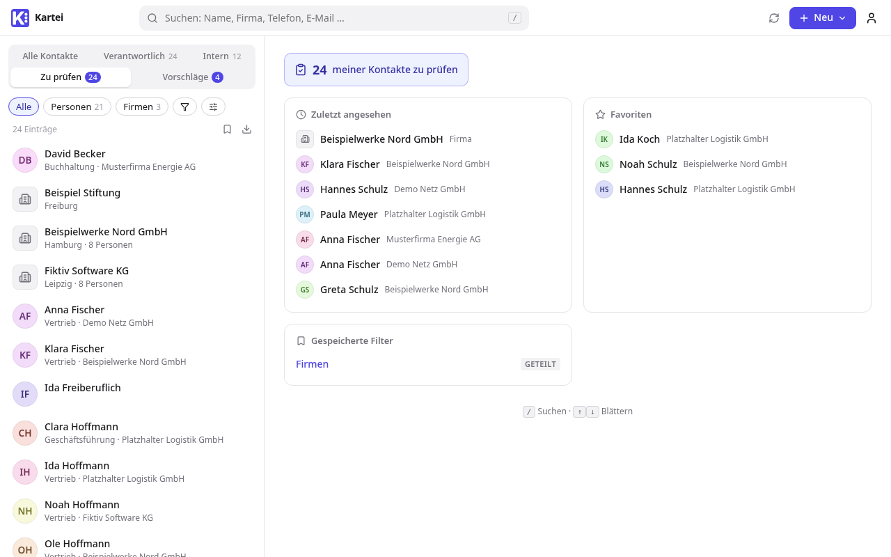

### Eine Prüfung beantworten

Öffne einen Kontakt aus der Liste **Zu prüfen**. Ein blauer Hinweis **Bitte prüfen** fragt, ob die Angaben noch stimmen (bei Firmen auch, ob es die Firma noch gibt).

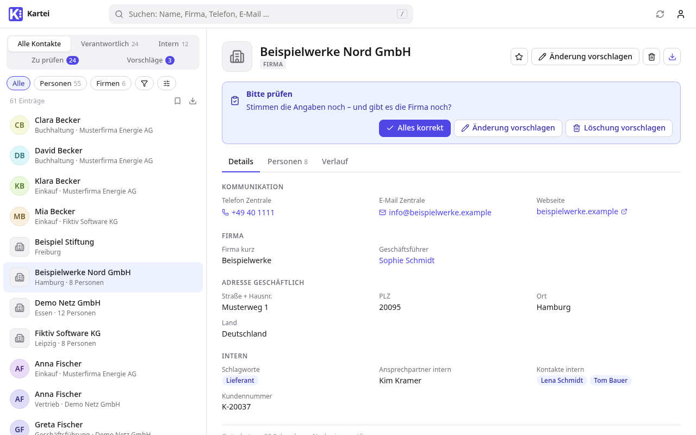

Mit der Rolle *Nur Lesen* hast du drei Antworten:

- **Alles korrekt:** alles aktuell. Die Prüfung ist erledigt, am Kontakt steht *Geprüft … von* dir.
- **Änderung vorschlagen:** etwas stimmt nicht oder fehlt. Siehe [Änderung vorschlagen](#aenderung-vorschlagen).
- **Löschung vorschlagen:** der Kontakt soll weg. Siehe [Löschung vorschlagen](#loeschung-vorschlagen).

Mit dem Absenden eines Vorschlags ist deine Prüfung ebenfalls erledigt – **Alles korrekt** brauchst du danach nicht mehr. Der Kontakt verschwindet dann aus deiner Liste **Zu prüfen**.

**Bearbeiter** sehen im Prüfhinweis stattdessen **Alles korrekt** und **Bearbeiten**. Du korrigierst den Kontakt direkt; sobald du eine Änderung speicherst, ist deine Prüfung ebenfalls erledigt. Soll der Kontakt weg, lösch ihn (siehe [Löschen und wiederherstellen](#loeschen-und-wiederherstellen)).

### Änderung vorschlagen {#aenderung-vorschlagen}

Mit der Rolle *Nur Lesen* kannst du jederzeit Änderungen vorschlagen, nicht nur bei einer Prüfung.

1. Öffne den Kontakt und klick auf **Änderung vorschlagen** (oben oder im Prüfhinweis).
2. Korrigiere die Felder im Formular. Oben steht zur Erinnerung: *Deine Änderungen werden nicht direkt gespeichert, sondern einem Bearbeiter zur Freigabe vorgelegt.*
3. Erklär die Änderung bei Bedarf unter **Kommentar (optional)**, z. B. „laut E-Mail-Signatur“.
4. Klick auf **Vorschlag senden**.

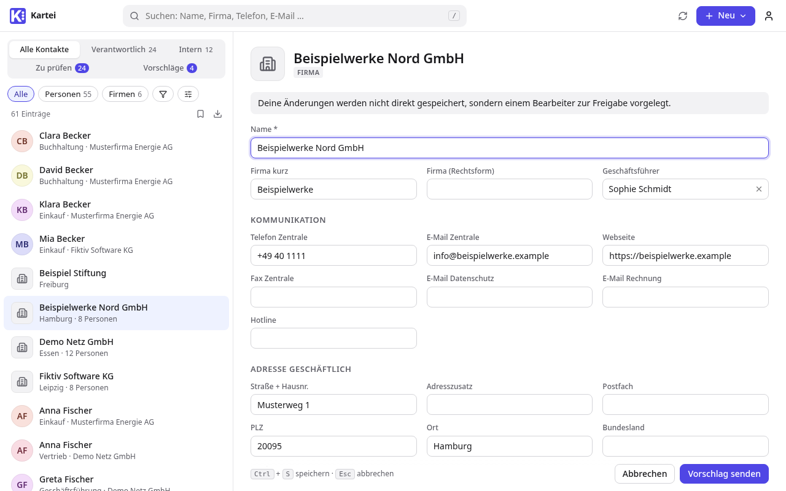

Ein Bearbeiter übernimmt deinen Vorschlag dann, passt ihn an oder lehnt ihn ab. Das Bild eines Kontakts kannst du über einen Vorschlag nicht ändern.

### Löschung vorschlagen {#loeschung-vorschlagen}

1. Öffne den Kontakt und klick im Prüfhinweis auf **Löschung vorschlagen** oder oben auf den Papierkorb-Knopf (**Löschung vorschlagen**).
2. Wähle einen Grund:
   - **Hat das Unternehmen verlassen** (nur bei Personen): die Person arbeitet dort nicht mehr.
   - **Firma existiert nicht mehr**: die Firma ist aufgelöst. Das gilt immer für die ganze Firma: Wird der Vorschlag angenommen, werden die Firma **und alle ihre Personen** gelöscht. Kartei zeigt an, wie viele Personen betroffen sind. Du kannst diesen Grund bei der Firma oder bei jeder ihrer Personen wählen.
   - **Anderer Grund**: beschreib den Grund im Kommentarfeld – hier ist der Kommentar Pflicht.
3. Klick auf **Vorschlag senden**.

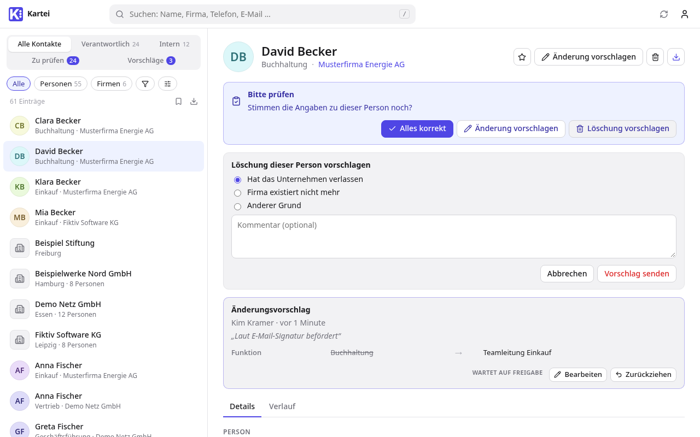

Bei einer Firma gibt es nur **Firma existiert nicht mehr** und **Anderer Grund**:

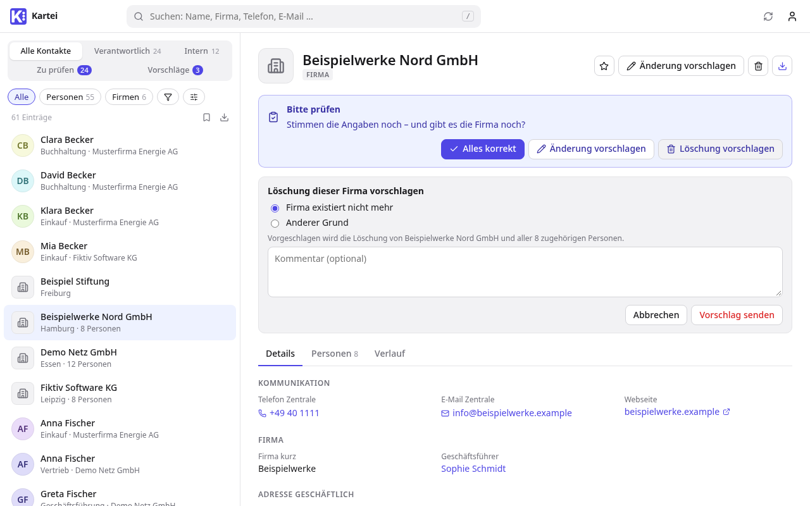

> Ein Löschvorschlag wird erst ausgeführt, wenn ein Bearbeiter ihn übernimmt. Bis dahin bleibt der Kontakt für alle sichtbar.
{: .warn}

Hat schon jemand gemeldet, dass die Firma nicht mehr existiert, sagt Kartei dir das (*Das wurde für diese Firma bereits gemeldet – es wartet auf Freigabe.*), und deine Prüfung gilt trotzdem als erledigt.

### Neuen Kontakt vorschlagen {#neuen-kontakt-vorschlagen}

Mit der Rolle *Nur Lesen* kannst du auch neue Personen und Firmen vorschlagen, etwa eine neue Ansprechpartnerin bei einem Kunden.

1. Klick oben rechts auf **Neu** und wähle **Neue Person vorschlagen** oder **Neue Firma vorschlagen** (oder drück <kbd>N</kbd> bzw. <kbd>Umschalt</kbd>+<kbd>N</kbd>).
2. Füll das Formular aus, soweit du die Angaben kennst. Pflichtfelder sind mit **\*** markiert; oben steht zur Erinnerung: *Der Kontakt wird nicht direkt angelegt, sondern einem Bearbeiter zur Freigabe vorgelegt.*
3. Erklär bei Bedarf unter **Kommentar (optional)**, woher die Angaben stammen.
4. Klick auf **Vorschlag senden**.

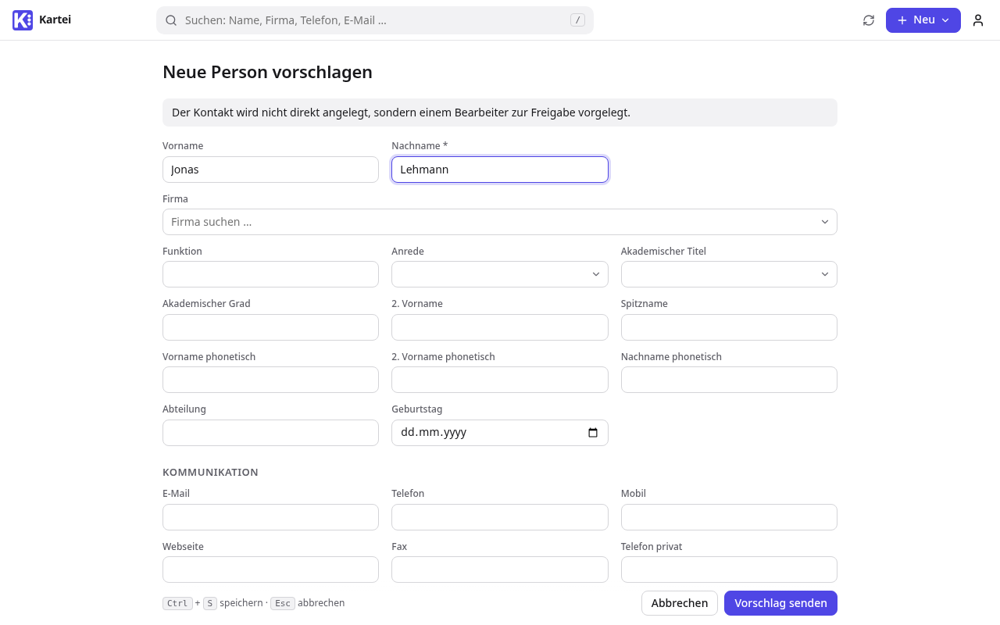

Kartei zeigt deinen Vorschlag dann auf einer eigenen Seite, und er erscheint in der Liste **Vorschläge** mit dem Kennzeichen **neu**. Bis ein Bearbeiter entschieden hat, kannst du ihn dort **Bearbeiten** oder **Zurückziehen**. Ein Bild ergänzt der Bearbeiter, nachdem der Kontakt angelegt ist.

### Eigenen Vorschlag ändern oder zurückziehen

Solange noch niemand entschieden hat, steht dein Vorschlag am Kontakt mit dem Hinweis **Wartet auf Freigabe**. Alle deine offenen Vorschläge findest du in der Liste **Vorschläge**. Am Kontakt kannst du:

- **Bearbeiten:** vorgeschlagene Werte oder Kommentar ändern (nur bei Änderungsvorschlägen) und erneut **Vorschlag senden**.
- **Zurückziehen:** den Vorschlag nach einer Rückfrage ganz zurücknehmen.

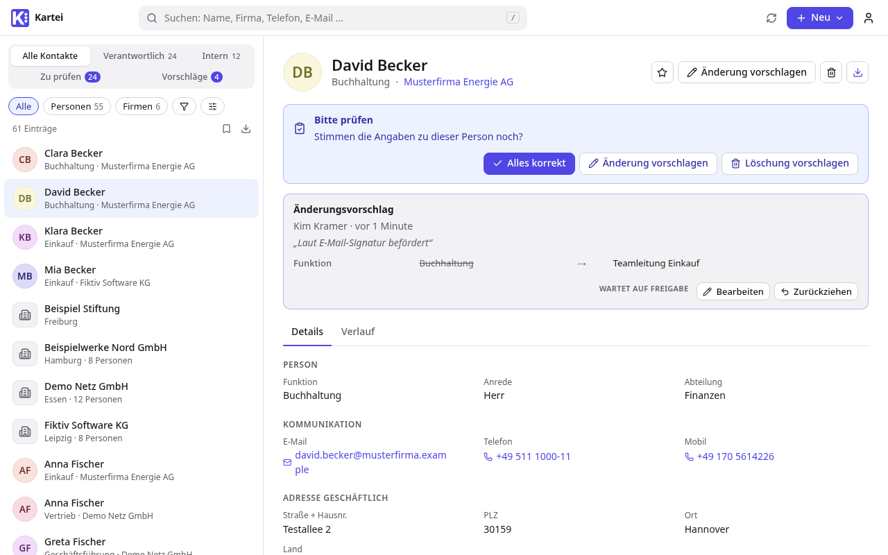

Sobald ein Bearbeiter entschieden hat, verschwindet der Vorschlag aus der Liste; die Entscheidung steht im **Verlauf** des Kontakts.

## Kontakte anlegen und bearbeiten

**Bearbeiter.** Mit der Rolle *Nur Lesen* gibt es den Knopf **Bearbeiten** nicht, und **Neu** legt nur einen Vorschlag an – du [schlägst](#neuen-kontakt-vorschlagen) Änderungen und neue Kontakte stattdessen vor.

### Person oder Firma anlegen

1. Klick oben rechts auf **Neu** und wähle **Person** oder **Firma** (oder drück <kbd>N</kbd> für eine Person, <kbd>Umschalt</kbd>+<kbd>N</kbd> für eine Firma).
2. Füll die Felder aus. Pflichtfelder sind mit **\*** markiert – bei einer Person mindestens **Nachname**, bei einer Firma **Name**.
3. Klick auf **Anlegen** (oder <kbd>Strg</kbd>+<kbd>S</kbd>).

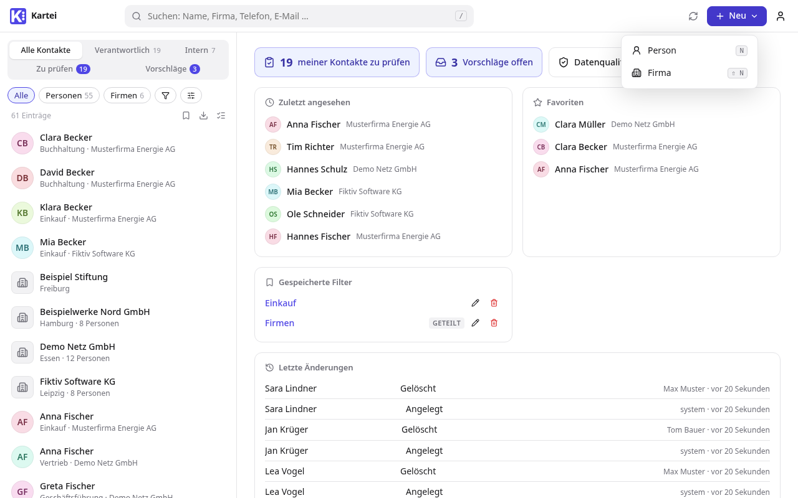

Die **Firma** einer Person wählst du, indem du einen Teil des Namens tippst (*Firma suchen …*). Für einen neuen Mitarbeiter einer Firma geht es noch schneller: Firma öffnen, Reiter **Personen**, **Person bei dieser Firma anlegen** – die Firma ist dann schon eingetragen.

### Angaben von der Firma übernehmen

Sobald eine Person eine Firma hat, bietet Kartei an, Angaben der Firma zu übernehmen, etwa Webseite, Adresse oder internen Ansprechpartner: **Angaben von … übernehmen**.

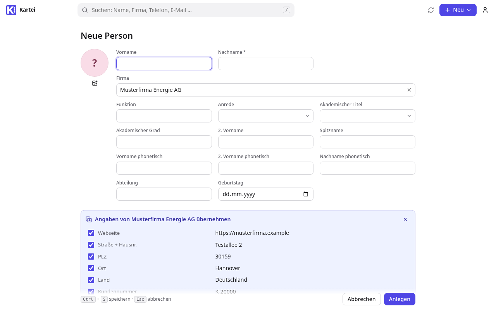

1. Nimm die Haken bei Werten heraus, die du nicht willst. Werte mit **überschreibt** würden etwas bereits Eingetragenes ersetzen; sie sind anfangs nicht angehakt.
2. Klick auf **… übernehmen** (der Knopf zeigt, wie viele Werte übernommen werden).

**Rückgängig** macht die Übernahme rückgängig. Das **×** schließt den Kasten, ohne etwas zu übernehmen.

### Hinweis auf Dubletten

Schon während der Eingabe prüft Kartei, ob es einen ähnlichen Kontakt gibt: gleiche E-Mail-Adresse, gleiche Telefonnummer oder gleicher Name (bei Personen: in derselben Firma). Dann erscheint ein gelber Hinweis **Mögliche Dublette:** mit Links zu bis zu drei Treffern. Die Links öffnen sich in einem neuen Tab, deine Eingaben bleiben also erhalten. Schau sie dir an, bevor du einen zweiten Eintrag anlegst.

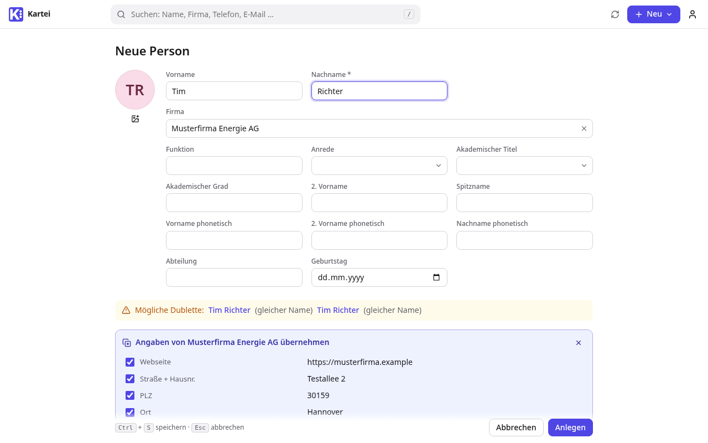

### Einen Kontakt bearbeiten

Öffne den Kontakt und klick auf **Bearbeiten** (oder drück <kbd>E</kbd>). Ändere die Felder und klick auf **Speichern** (<kbd>Strg</kbd>+<kbd>S</kbd>). **Abbrechen** (<kbd>Esc</kbd>) verlässt das Formular; bei ungespeicherten Änderungen fragt Kartei *Ungespeicherte Änderungen verwerfen?* – mit **Weiter bearbeiten** oder **Verwerfen**.

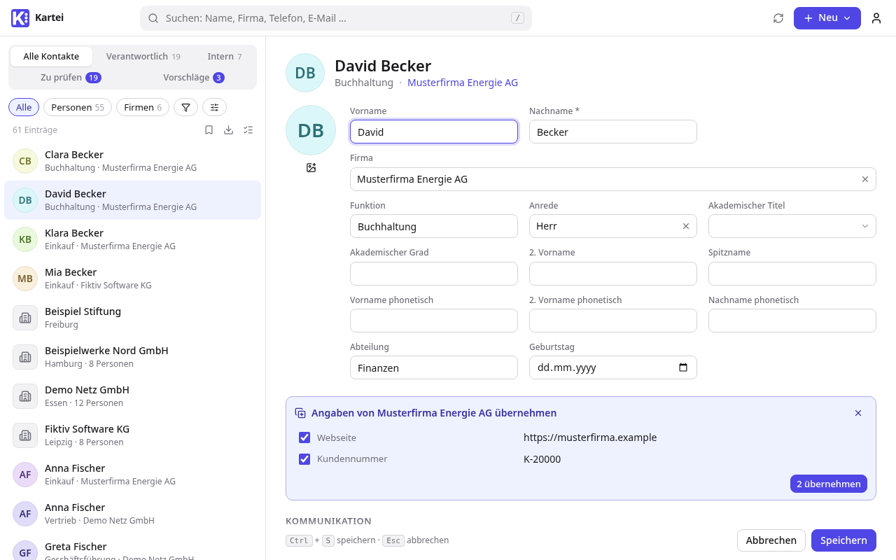

- **Bild:** Über das Bild-Symbol unter dem Avatar kannst du ein Bild hochladen (**Bild hochladen**; PNG, JPEG oder WebP, es wird automatisch verkleinert). Bei einem bestehenden Kontakt wird das Bild sofort gespeichert. **Bild entfernen** fragt nach und löscht es dann ebenfalls sofort.
- **Hilfetexte** unter manchen Feldern erklären, was hineingehört.
- **Ausgegraute Felder** darf nur die Administration ändern.
- **Telefonnummern** dürfen Ziffern, Leerzeichen und `+ ( ) / -` enthalten. Je nach Einstellung werden nationale Nummern international gespeichert, aus `0511 1000-12` wird dann `+49 511 1000-12`.

### Wenn das Speichern nicht klappt

Kartei prüft deine Eingaben schon beim Tippen und beim Verlassen eines Felds: Ungültige Felder werden rot markiert, darunter steht der Grund, z. B. *Pflichtfeld*, *Keine gültige E-Mail-Adresse* oder *Entspricht nicht dem vorgegebenen Format*. Beim Speichern wird alles noch einmal geprüft (auch auf dem Server); stimmt dann noch etwas nicht, meldet Kartei *Bitte die markierten Felder prüfen*. Korrigier die markierten Felder und speicher erneut.

Hat jemand anderes denselben Kontakt gespeichert, während du ihn bearbeitet hast, zeigt Kartei *… hat diesen Kontakt inzwischen geändert.* Du hast zwei Möglichkeiten:

- **Deren Stand anzeigen:** verwirft deine Eingaben und zeigt den Kontakt so, wie die andere Person ihn gespeichert hat. Danach kannst du erneut bearbeiten.
- **Meine Änderungen trotzdem speichern:** speichert die Felder, die *du* geändert hast, auf den anderen Stand. Felder, die du nicht angefasst hast, behalten die Werte der anderen Person.

> Habt ihr beide dasselbe Feld geändert, gewinnt dein Wert. Im Zweifel nimm **Deren Stand anzeigen** und vergleich zuerst.
{: .tip}

### Auswahlfelder, Benutzer und verknüpfte Personen

- **Auswahlfelder** (z. B. *Anrede*, *Schlagworte*): Tipp, um die Optionen zu durchsuchen. Manche Felder erlauben neue Werte: neuen Wert eintippen und **„…“ hinzufügen** wählen. Er steht dann allen als Option zur Verfügung.
- **Benutzerfelder** (z. B. *Ansprechpartner intern*, *Kontakte intern*): Kolleginnen und Kollegen nach Name oder Benutzername auswählen (Administratoren werden nicht angeboten). Der *Ansprechpartner intern* ist für den Kontakt verantwortlich und bekommt seine Prüfungen; darauf beruht die Liste **Verantwortlich**. Unter *Kontakte intern* können mehrere Personen stehen; darauf beruht die Liste **Intern**.
- **Verknüpfte Personen** (z. B. *Geschäftsführer* einer Firma): eine Person der Firma auswählen. Erlaubt das Feld freien Text, kannst du auch einen Namen tippen und **„…“ als Text übernehmen** wählen.

### Firmenänderungen und Mitarbeiter

Personen sind mit ihrer Firma verknüpft – benennst du eine Firma um, steht der neue Name sofort überall. Bei anderen Änderungen, etwa einer neuen Adresse oder Zentralnummer, fragt Kartei nach dem Speichern der Firma: **Auch bei … Mitarbeitern übernehmen?**

- **Übernommene Felder** (Adresse, Webseite, Hotline, …): Mitarbeiter, die noch den alten Wert der Firma haben, bekommen den neuen.
- **Telefonnummern:** Mitarbeiternummern, die mit der alten Firmennummer beginnen, bekommen die neue Nummer und behalten ihre Durchwahl.

Jede vorgeschlagene Änderung hat ein eigenes Häkchen. Nimm die Haken bei allem heraus, was sich nicht ändern soll, und klick auf **… Änderungen übernehmen** – oder auf **Nicht übernehmen**, dann bleiben die Mitarbeiter unverändert.

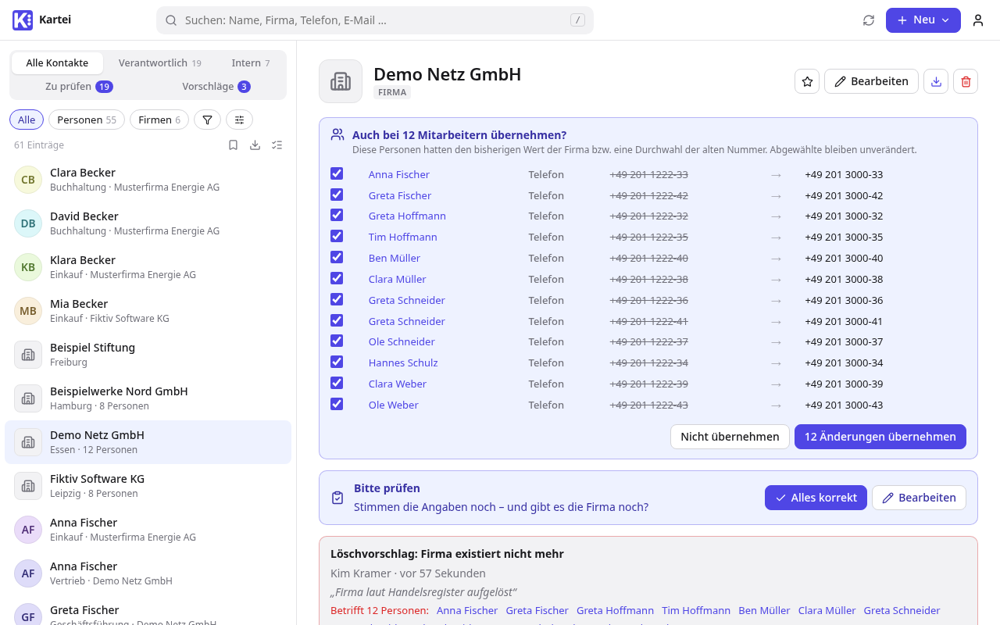

## Löschen und wiederherstellen {#loeschen-und-wiederherstellen}

**Bearbeiter.**

### Einen Kontakt löschen

Öffne den Kontakt und klick auf den roten Papierkorb (**Löschen**). Kartei fragt **In den Papierkorb verschieben?**; bestätige mit **In den Papierkorb** (oder <kbd>Enter</kbd>) oder behalte den Kontakt mit **Abbrechen** (oder <kbd>Esc</kbd>). Danach wandert der Kontakt in den Papierkorb, und die Meldung unten bietet einige Sekunden lang **Rückgängig** an.

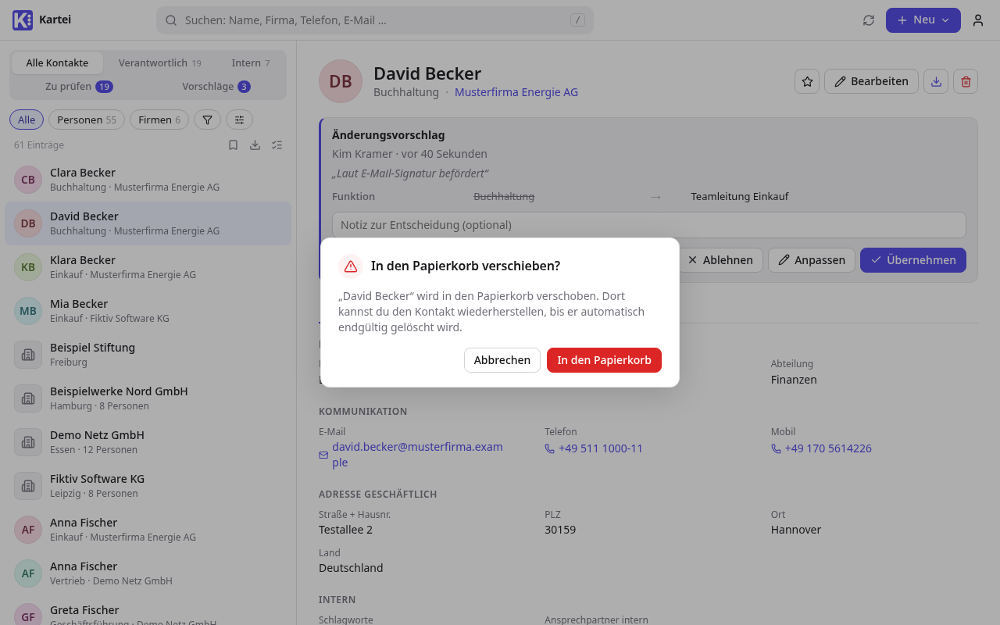

> Alles, was etwas löscht, fragt vorher in diesem Dialog nach: Kontakte löschen, endgültig aus dem Papierkorb löschen, ein Bild entfernen, einen gespeicherten Filter löschen und einen Vorschlag zurückziehen. Der Dialog sagt, was mit den Daten passiert. <kbd>Esc</kbd> oder ein Klick neben den Dialog bricht ab.
{: .tip}

**Eine Firma löschen:** Der Dialog nennt die Zahl der Personen der Firma und bietet **Auch ihre … Personen in den Papierkorb verschieben** an. Das Häkchen ist zunächst **nicht gesetzt**:

- Ohne Häkchen wird nur die Firma gelöscht. Ihre Personen bleiben im Verzeichnis und behalten den Firmennamen, die Firma selbst liegt aber im Papierkorb.
- Setz das Häkchen, wenn die Firma aufgelöst ist und die Belegschaft mit verschwinden soll. Firma und alle ihre Personen wandern gemeinsam in den Papierkorb; im Verlauf jeder Person steht *Mit Firma gelöscht*.

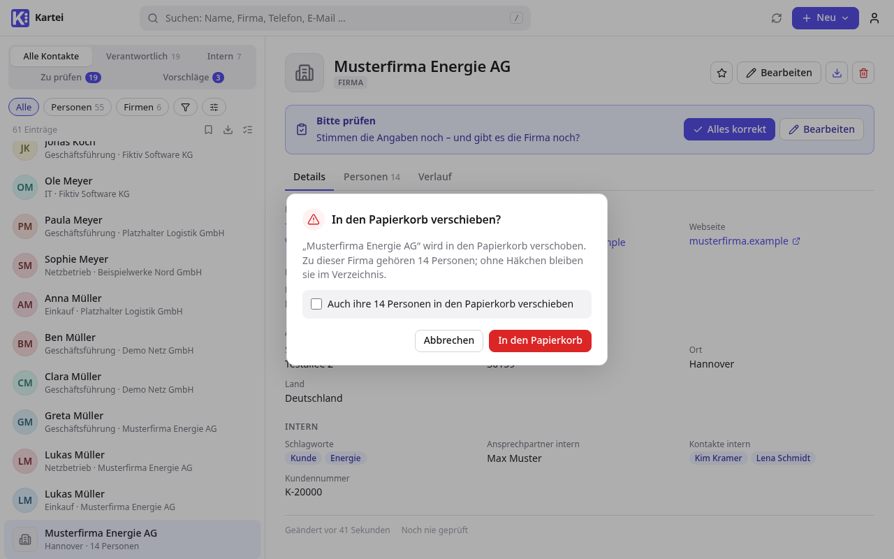

**Rückgängig** in der Meldung holt die Firma zusammen mit den mitgelöschten Personen zurück. Im Papierkorb kannst du sie auch einzeln wiederherstellen.

### Der Papierkorb

Öffne **Papierkorb** im Benutzermenü. Dort stehen die gelöschten Kontakte mit Zeitpunkt und dem Benutzer, der sie gelöscht hat. **Wiederherstellen** holt einen Kontakt mit allen Daten und dem Verlauf zurück.

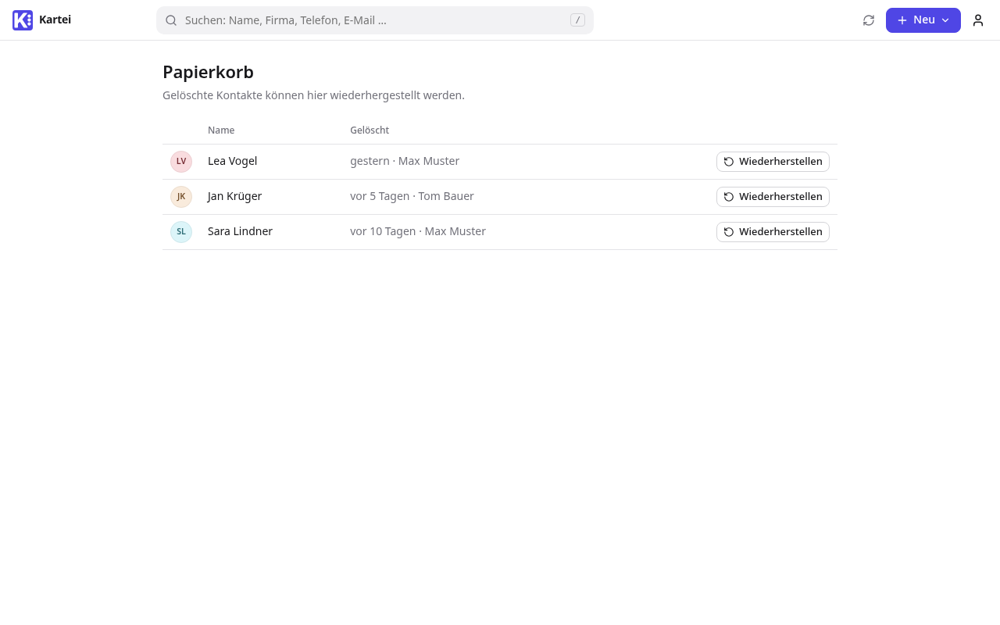

Wie lange gelöschte Kontakte im Papierkorb bleiben, legt die Administration fest; danach werden sie endgültig gelöscht. Von Hand endgültig löschen kann nur die Administration (Papierkorb-Symbol im Papierkorb, **Endgültig löschen**). Der Dialog warnt, dass sich das nicht rückgängig machen lässt; bei einer Firma nennt er auch, wie viele Personen ihre Firma verlieren.

## Mehrere Kontakte bearbeiten

**Bearbeiter.** Damit änderst du viele Kontakte auf einmal, zum Beispiel um ein Schlagwort zu ergänzen oder Kontakte an eine neue Kollegin zu übergeben.

1. Grenz die Liste mit Suche, Liste und Filtern ein (auch mit dem erweiterten Filter).
2. Klick auf den Auswahl-Knopf über der Liste (**Mehrere bearbeiten**). Es erscheinen Häkchen.
3. Klick die gewünschten Kontakte an. <kbd>Umschalt</kbd>+Klick wählt einen Bereich. **Alle … auswählen** nimmt die ganze Liste, **Keine** hebt die Auswahl auf.
4. Wähle eine **Aktion** und, falls nötig, **Feld** und Wert.
5. Klick auf **Auf … anwenden**.

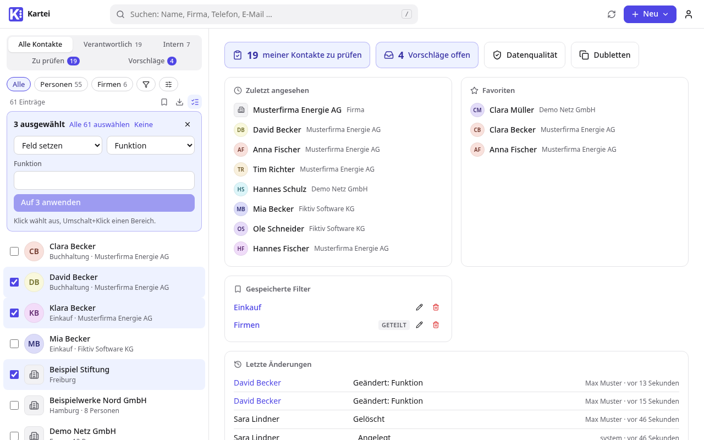

| Aktion | Macht |
|---|---|
| **Feld setzen** | setzt das Feld bei allen ausgewählten Kontakten auf den Wert |
| **Feld leeren** | leert das Feld |
| **Werte hinzufügen** | ergänzt Werte in einem Mehrfachauswahl-Feld (z. B. *Schlagworte*), vorhandene bleiben |
| **Werte entfernen** | entfernt Werte aus einem Mehrfachauswahl-Feld |
| **Verantwortlichen setzen** | setzt den verantwortlichen Benutzer (*Ansprechpartner intern*) |
| **In den Papierkorb** | löscht die ausgewählten Kontakte nach einer Rückfrage (**… Kontakte in den Papierkorb verschieben?**). Sind Firmen ausgewählt, bietet der Dialog **Auch deren … Personen in den Papierkorb verschieben** für nicht ausgewählte Personen dieser Firmen an (zunächst ohne Häkchen). |

Kontakte, die sich nicht ändern ließen (z. B. weil ein Pflichtfeld leer würde), bleiben ausgewählt, und eine Meldung nennt sie mit Grund. Die Änderungen stehen im Verlauf jedes Kontakts. Mit **×** (**Auswahl beenden**) schließt du die Auswahl.

## Über Vorschläge entscheiden

**Bearbeiter.** Schlagen Kolleginnen und Kollegen Änderungen, Löschungen oder neue Kontakte vor, zeigt die Startseite **… Vorschläge offen**, und die Liste **Vorschläge** erscheint. Öffne einen Kontakt aus dieser Liste – der Vorschlag steht über den Details.

### Änderungsvorschläge

Der Vorschlag zeigt, wer ihn wann geschickt hat, den Kommentar und eine Tabelle mit aktuellem und vorgeschlagenem Wert je Feld.

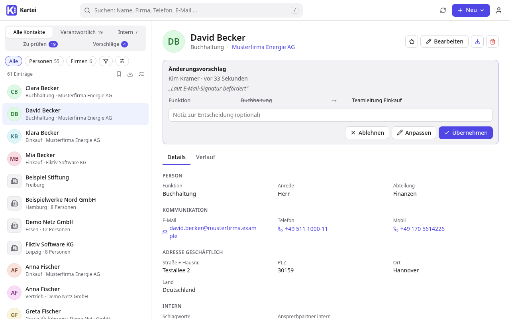

- **Übernehmen:** führt die Änderung wie vorgeschlagen aus.
- **Anpassen:** öffnet das Formular mit den vorgeschlagenen Werten. Korrigier, was nötig ist, und klick auf **Übernehmen** – deine Werte werden gespeichert, und der Vorschlag gilt als angenommen.
- **Ablehnen:** lehnt den Vorschlag ab; der Kontakt bleibt, wie er ist.

Vorher kannst du eine **Notiz zur Entscheidung (optional)** schreiben; sie landet im Verlauf.

Wurde der Kontakt geändert, nachdem der Vorschlag kam, ist der betroffene Wert mit **inzwischen geändert** markiert. Übernehmen würde diesen neueren Wert überschreiben – prüf ihn also vorher und nimm im Zweifel **Anpassen**.

### Löschvorschläge

Ein Löschvorschlag zeigt Grund und Kommentar. **Löschen** verschiebt den Kontakt in den Papierkorb, **Ablehnen** behält ihn.

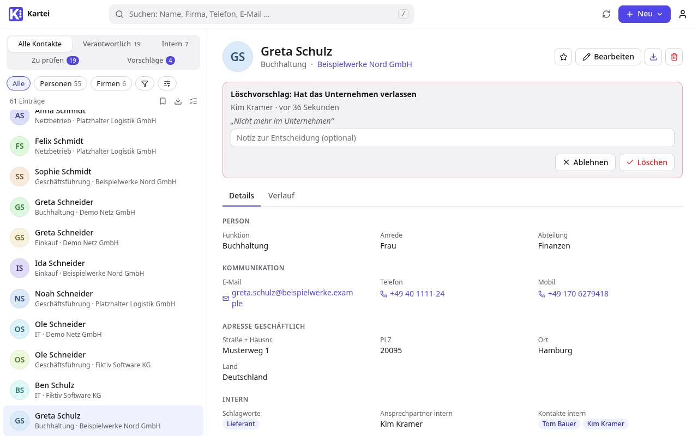

Bei **Firma existiert nicht mehr** steht der Vorschlag an der Firma und listet die betroffenen Personen auf (*Betrifft … Personen:*). **Löschen** verschiebt die Firma **und alle ihre Personen** in den Papierkorb.

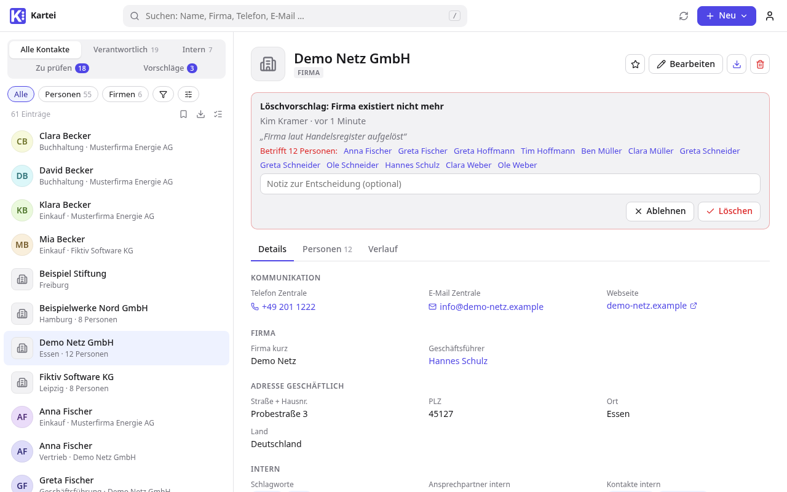

Die Personen einer solchen Firma zeigen einen Hinweis (*Für … wurde gemeldet, dass die Firma nicht mehr existiert.*) mit dem Link **Zur Firma**, damit du dort entscheiden kannst.

### Vorschläge für neue Kontakte

Vorgeschlagene neue Personen und Firmen gibt es noch nicht, deshalb stehen sie oben in der Liste **Vorschläge**, gekennzeichnet mit **neu**. Ein Klick öffnet die Seite des Vorschlags: wer ihn wann geschickt hat, der Kommentar und alle vorgeschlagenen Werte.

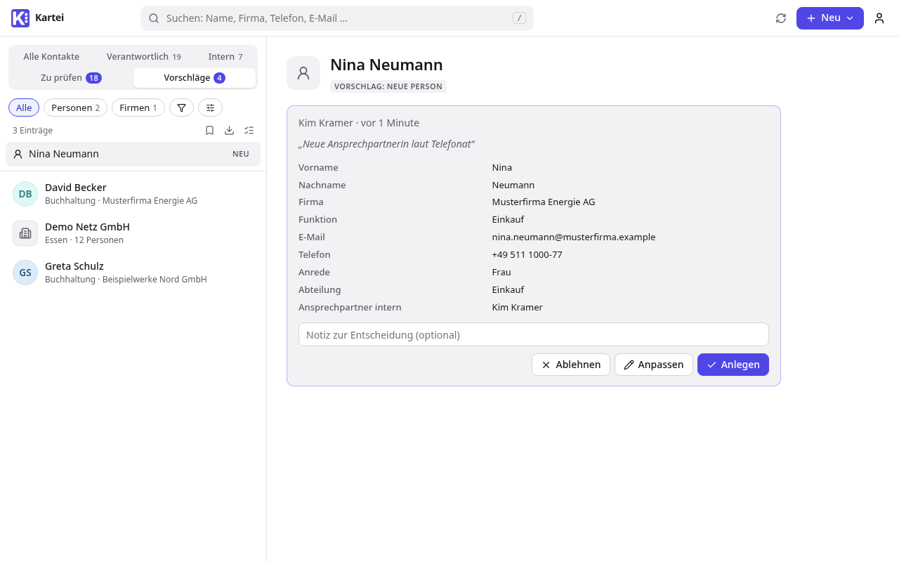

- **Anlegen:** legt den Kontakt mit den vorgeschlagenen Werten an und öffnet ihn.
- **Anpassen:** öffnet das Formular mit den vorgeschlagenen Werten, z. B. um Firma oder Ansprechpartner intern zu ergänzen. **Anlegen** speichert deine Werte, und der Vorschlag gilt als angenommen.
- **Ablehnen:** lehnt den Vorschlag ab; es wird kein Kontakt angelegt.

Prüf vor dem Anlegen, ob es den Kontakt schon gibt: Das Formular zeigt dazu wie gewohnt den Hinweis auf mögliche Dubletten.

> Jede Entscheidung samt Notiz steht im Verlauf des Kontakts. Gelöschte Kontakte lassen sich aus dem Papierkorb wiederherstellen.
{: .tip}

## Datenqualität

**Bearbeiter.** Öffne **Datenqualität** über die Startseite oder das Benutzermenü. Die Seite zeigt, wie viele Kontakte in welchem Bereich Aufmerksamkeit brauchen; ein Klick auf einen Bereich listet die Kontakte zum Öffnen auf.

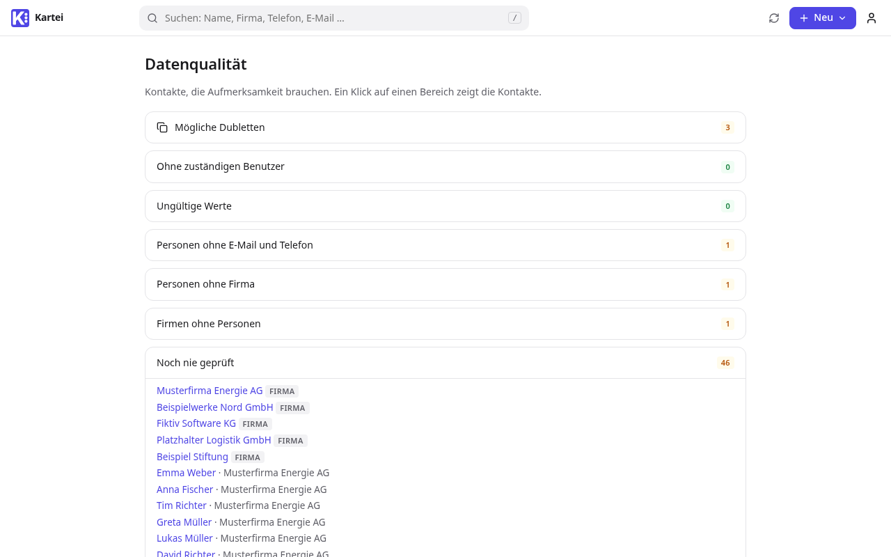

| Bereich | Bedeutet |
|---|---|
| **Mögliche Dubletten** | führt zur Dubletten-Seite |
| **Ohne zuständigen Benutzer** | kein *Ansprechpartner intern*; diese Kontakte können nicht geprüft werden |
| **Ungültige Werte** | gespeicherte Werte, die nicht den Regeln des Felds entsprechen, z. B. nach einem Import; der Grund steht dabei |
| **Personen ohne E-Mail und Telefon** | die Person ist nicht erreichbar |
| **Personen ohne Firma** | Personen, die mit keiner Firma verknüpft sind |
| **Firmen ohne Personen** | Firmen ohne Mitarbeiter in Kartei |
| **Noch nie geprüft** | Kontakte, die noch nie geprüft wurden |
| **Prüfung überfällig** | die letzte Prüfung ist älter als das Prüfintervall |

## Dubletten zusammenführen

**Bearbeiter.** Öffne **Dubletten** über die Startseite, das Benutzermenü oder die **Datenqualität**. Kartei listet Paare gleicher Art mit derselben E-Mail-Adresse, Telefonnummer oder demselben Namen (Personen: in derselben Firma). Die Spalte **Übereinstimmung** zeigt, warum.

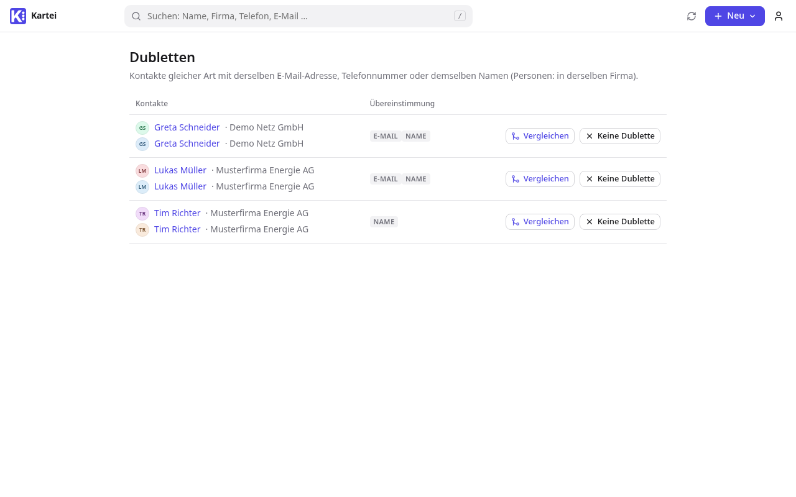

- **Keine Dublette:** die beiden sind wirklich verschiedene Kontakte. Das Paar wird dauerhaft ausgeblendet.
- **Vergleichen:** öffnet die Seite zum Zusammenführen.

### Zwei Kontakte zusammenführen

1. Wähle oben, welcher Kontakt **bleibt**; der andere **wird zusammengeführt**. Vorausgewählt ist der zuletzt geänderte.
2. Wähle für jedes Feld, welcher Wert gilt. Bei Mehrfachauswahl-Feldern wie *Schlagworte* geht auch **Beide**.
3. Klick auf **Zusammenführen**.

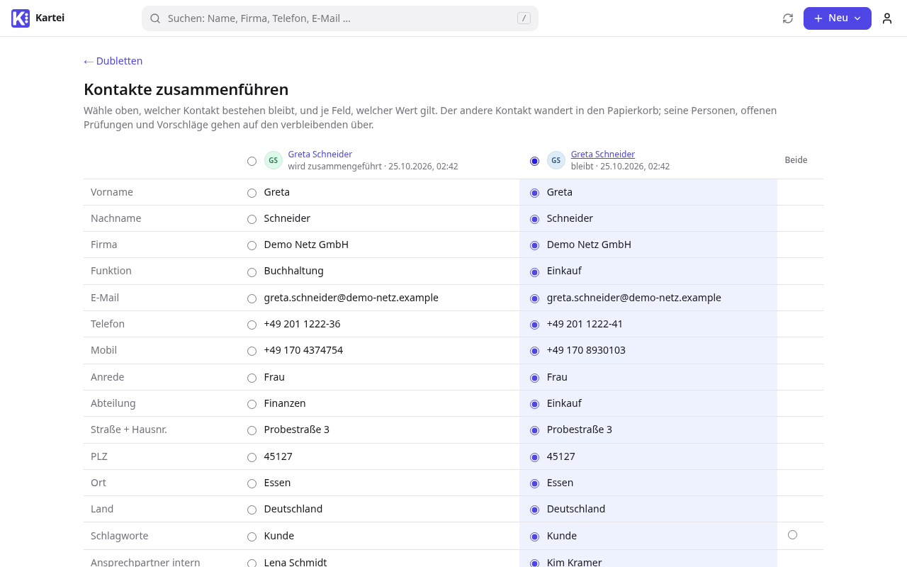

Der verbleibende Kontakt behält beide Verläufe. Mitarbeiter, offene Prüfungen und Vorschläge des anderen Kontakts gehen auf ihn über. Der andere Kontakt wandert in den Papierkorb, und Links auf ihn führen zum verbleibenden Kontakt.

## Tastenkürzel

| Taste | Aktion |
|---|---|
| <kbd>/</kbd> | zur Suche springen |
| <kbd>↑</kbd> <kbd>↓</kbd> | durch die Treffer blättern |
| <kbd>Enter</kbd> | in der Suche: ersten oder ausgewählten Treffer öffnen |
| <kbd>Esc</kbd> | in der Suche: leeren, dann verlassen; im Formular: abbrechen |
| <kbd>E</kbd> | geöffneten Kontakt bearbeiten (Bearbeiter) |
| <kbd>N</kbd> / <kbd>Umschalt</kbd>+<kbd>N</kbd> | neue Person / neue Firma (Nur Lesen: vorschlagen) |
| <kbd>Strg</kbd>+<kbd>S</kbd> | Formular speichern (auf dem Mac auch <kbd>Cmd</kbd>+<kbd>S</kbd>) |

Während du in einem Feld tippst, sind die Kürzel aus – außer <kbd>Strg</kbd>+<kbd>S</kbd> und <kbd>Esc</kbd> im Formular sowie Pfeiltasten und <kbd>Enter</kbd> in der Suche.

## Kontakte auf dem Handy

Nutzt deine Organisation das, können die Kontakte aus Kartei auch im Adressbuch deines Handys erscheinen – dann siehst du bei Anrufen, wer anruft. Eingerichtet wird das von der IT bzw. der Administration:

- **Outlook-App (iPhone und Android):** Nutzt deine Organisation Microsoft 365, legt Kartei die Kontakte in einem Ordner in deinem Postfach ab. Schalte in der Outlook-App für dein Konto *Kontakte speichern* ein (*Einstellungen* → Konto → *Kontakte speichern*), damit sie auf dem Handy gespeichert werden.
- **CardDAV-Konto (iPhone):** die Alternative, z. B. für Telefone ohne eigenes Postfach. Serveradresse und Zugangsdaten bekommst du von der Administration. Die Kontakte erscheinen als eigenes Adressbuch und lassen sich auf dem Handy nicht ändern.

Synchronisiert werden nur Felder, die für alle sichtbar sind. Geändert wird in Kartei, nicht auf dem Handy; beim nächsten Abgleich kommt die Änderung aufs Handy.
