# User manual

Kartei is a contact directory for persons and companies. Depending on how your organization has set it up, the contacts you maintain here also appear on phones, in Outlook, in caller ID and in exports for other systems. This manual covers everyday work with Kartei for the two non-admin roles:

| | Read only | Maintainer |
|---|:---:|:---:|
| View, search and filter contacts, download vCards | ✓ | ✓ |
| Export lists (Excel, CSV), save filters, set favorites | ✓ | ✓ |
| Confirm your own reviews (*All correct*) | ✓ | ✓ |
| Propose changes and deletions | ✓ | – |
| Propose new persons and companies | ✓ | – |
| See your own pending proposals in the list *Proposals* | ✓ | – |
| Create, edit and delete contacts, edit several at once | – | ✓ |
| Restore contacts from the recycle bin | – | ✓ |
| Apply, adjust or reject proposals | – | ✓ |
| Data quality, duplicates and merging, recent changes | – | ✓ |

Sections that only apply to maintainers are marked **Maintainers**. Administrators set up fields, users, exports and the phone syncs; that is covered in the admin manual. The field names in this manual come from the standard field set, so your installation may use different names.

## Getting started

### Signing in

Open the Kartei address your IT department gave you and sign in with your **Username** and **Password**. Depending on your organization's setup, these are your usual network (e.g. Windows) credentials or a separate Kartei account. The buttons below the form switch the language between *Deutsch* and *English*.

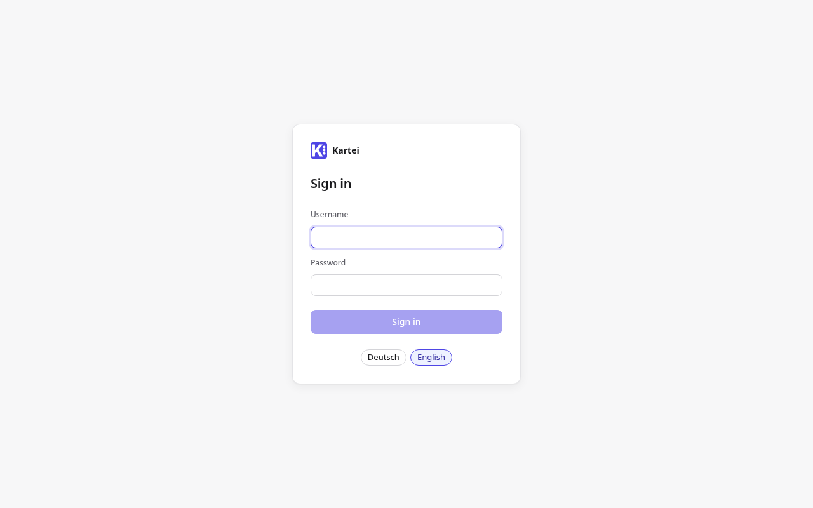

If you enter a wrong password too many times, Kartei blocks further attempts for 15 minutes (*Too many attempts – please wait 15 minutes*). To leave Kartei, choose **Sign out** in the user menu.

### Installing the app

You can install Kartei as an app. It then opens in its own window and, after the first sync, it also starts without a network connection.

- **Computer (Chrome or Edge):** click the install icon at the right end of the address bar, or choose *Install* in the browser menu.
- **iPhone:** open Kartei in Safari, tap *Share*, then *Add to Home Screen*.
- **Android:** open Kartei in Chrome and choose *Add to Home screen* or *Install app* from the browser menu.

When there is no connection, a crossed-out Wi-Fi icon appears at the top right (*Offline – showing cached data*). You can still search and read contacts, but saving changes needs a connection.

### Language and appearance

Click the person icon at the top right to open the **user menu**. It shows your name and role, and you can change:

- the language: **Deutsch** or **English**
- the **Appearance**: **System** (follows your computer's setting), **Light** or **Dark**. This is saved separately on each device.

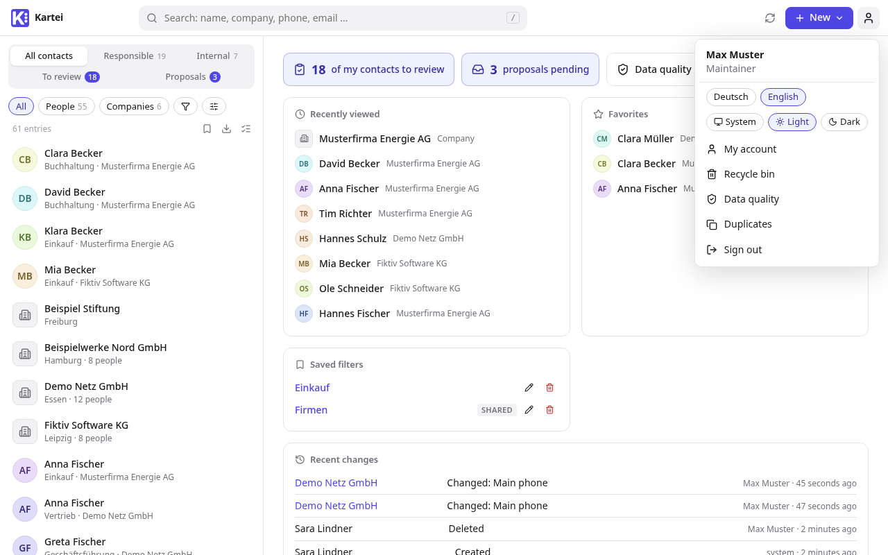

Under **My account** you can also choose the language (*Default (…)* uses the default language of your installation) and, if you have a local account, change your password (*New password (min. 10 characters)*). If you sign in with your network account, you change your password there (*Your password is managed in Active Directory.*).

At the bottom, the user menu shows the Kartei version (useful in bug reports) and a link to the **Source code**.

The screenshot shows a maintainer's menu. Read only users don't see **Recycle bin**, **Data quality** and **Duplicates**; administrators also see **Settings**.

### Two-factor sign-in

Under **My account** you can protect your account with a second factor: after your password, Kartei then also asks for a 6-digit code from an authenticator app on your phone (e.g. Microsoft Authenticator, Google Authenticator, 1Password).

1. *My account* → *Two-factor sign-in* → **Set up**.
2. Scan the QR code with the app (or enter the key shown below it by hand) and type the code the app shows. **Switch on**.
3. Kartei shows **8 recovery codes** once. Keep them safe, e.g. in your password manager: each works once instead of the app code if you don't have your phone at hand.

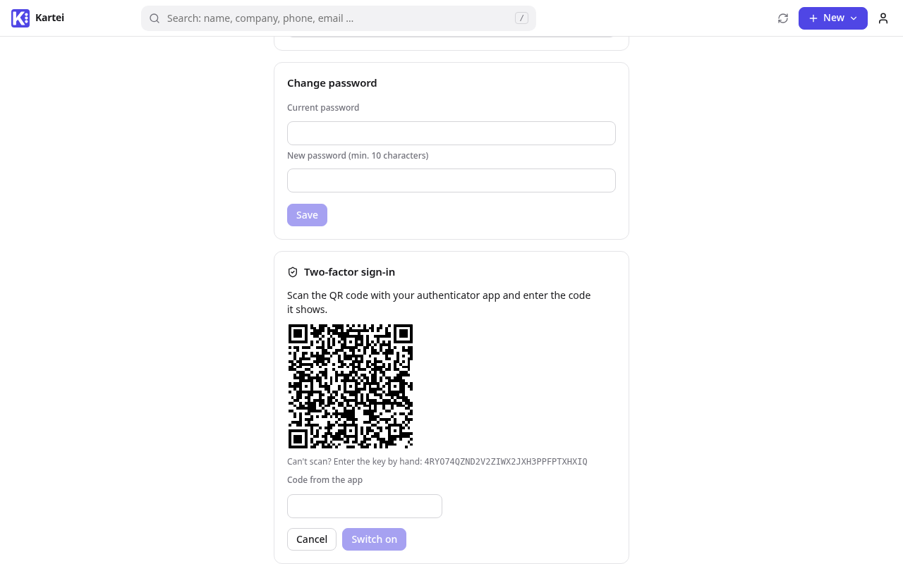

When signing in, Kartei asks for the code after the password. With the current code (or a recovery code) you can get **New recovery codes** or **Switch off** the two-factor sign-in on the same page. Lost your phone and the codes? Your administrator can reset it.

### The screen layout

- **Top bar:** search box, the sync button (**Sync now**), for maintainers the **New** button, and the user menu.
- **Left:** the contact list with the list switch, the filters and the list tools.
- **Right:** the selected contact or, if none is selected, your dashboard.

Kartei updates itself automatically every 30 seconds and whenever you return to the window. Use **Sync now** if you want to fetch changes immediately.

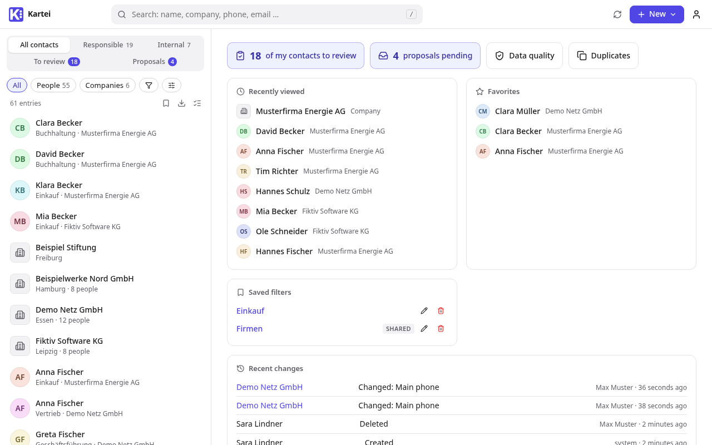

On a phone, Kartei shows either the list or the contact. Use the arrow at the top left of a contact to go back to the list.

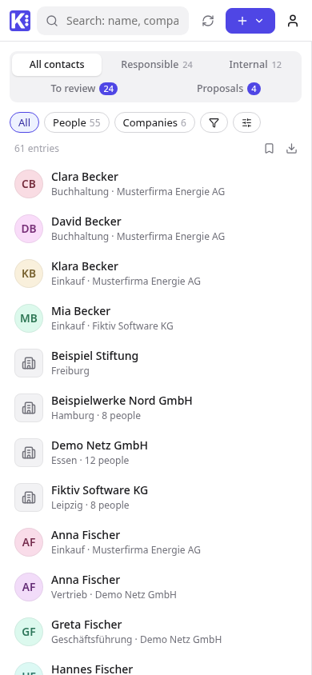{: width="320"} 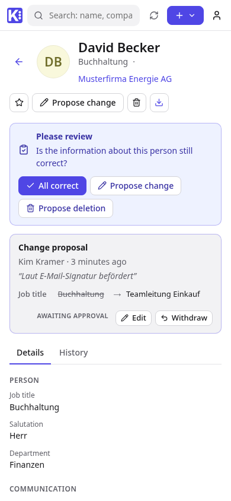{: width="320"}

## Finding contacts

### Search

Click into the search box or press <kbd>/</kbd> and start typing. The list filters as you type. The search covers names, companies, phone numbers, email addresses and all other searchable fields.

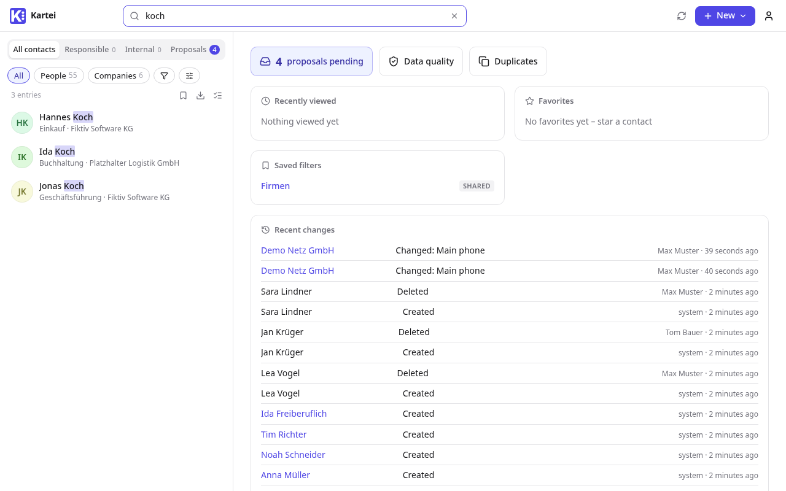

- **Several words** must all match: `meier lübeck` finds Meier in Lübeck.
- **Upper/lower case and umlauts** don't matter: `lubeck`, `luebeck` and `Lübeck` all find Lübeck.
- **Phone numbers** are found in any format: `0511 1000-12`, `+49 511 100012` and `051110001` all find the same number. Part of a number is enough, e.g. just the extension.
- The search also covers the person's company name, so `musterfirma` lists the company *Musterfirma Energie AG* and its employees.

Press <kbd>Enter</kbd> to open the first result, and <kbd>↑</kbd> <kbd>↓</kbd> to move through the results. <kbd>Esc</kbd> clears the search; pressing it again leaves the search box.

### Lists

The switch above the list chooses which contacts you see. Next to each list is the number of contacts in it.

| List | Shows |
|---|---|
| **All contacts** | all persons and companies |
| **Responsible** | contacts you are responsible for (you are their *Internal contact*) |
| **Internal** | contacts where you are one of the *Internal contacts* |
| **To review** | contacts you are asked to review (only while you have open reviews) |
| **Proposals** | contacts with pending change or deletion proposals: for maintainers all of them, for Read only users their own (only while there are some) |

Kartei remembers the last list you used.

### Persons or companies

The buttons below the list switch narrow the list down: **All**, **People** or **Companies**. The numbers show how many of each are in the current list.

### Field filters

The funnel button next to **Companies** (**Field filter**) opens the field filters. It offers the fields your administrator chose for quick filtering, e.g. *Keywords*, *Internal contact* and *Internal contacts*. Pick one or more values per field: a contact matches if it has one of the chosen values, and all filled-in fields must match.

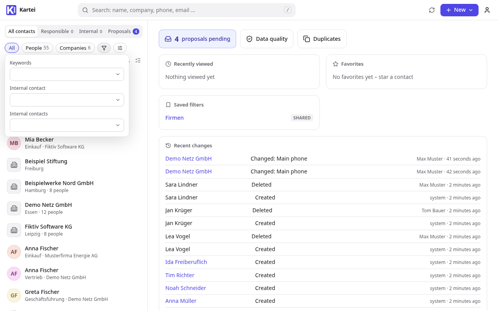

Active filters appear as small tags below the buttons. Click the **×** on a tag to remove that filter, or **Reset filters** in the filter menu to remove all of them.

### Advanced filter

For questions the field filters can't answer, e.g. "persons in Hannover who were never reviewed" or "contacts changed in the last 30 days", use the **Advanced filter**: the button with the sliders next to the funnel.

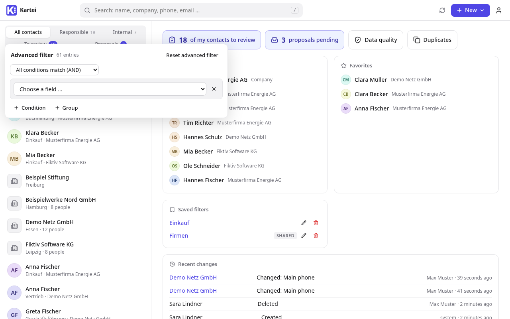

1. Click the sliders button. The header shows how many contacts currently match.
2. Click **Condition** (with the plus) and choose a field under **Choose a field …**. Besides all contact fields (**Fields**), you can use **Basic data** such as *Type (person/company)*, *Company (link)*, *Created at*, *Changed at*, *Reviewed at* or *Changed by*.
3. Choose the comparison and enter the value. The comparisons depend on the kind of field:
   - **Text:** *contains*, *does not contain*, *is*, *is not*, *starts with*. Like the search, upper/lower case and umlauts don't matter, and phone numbers are compared by their digits.
   - **Numbers:** *is*, *is not*, *less than (<)*, *at most (≤)*, *greater than (>)*, *at least (≥)*, *between*.
   - **Dates:** *is on*, *before*, *after*, *between*, *in the last … days*, *more than … days ago* and similar.
   - **Choice and user fields:** *is any of*, *is none of*; for fields with several values also *contains any of*, *contains all of*, *contains none of*.
   - **Yes/No fields:** *is checked*, *is not checked*.
   - Every field (except Yes/No fields): *is empty*, *is not empty*.
4. Add more conditions as needed. The selection at the top decides how they are combined: **All conditions match (AND)**, **At least one matches (OR)** or **None matches (NOT)**.
5. For more complex rules, click **Group** (with the plus): a group has its own combination and its own conditions. Groups can be nested up to three levels deep.

Conditions that are incomplete (no field, no value) are ignored. The advanced filter works on top of the search, the list, *People*/*Companies* and the field filters. While it is active, a tag **Advanced: … conditions** appears below the buttons; click it to open the filter again, or click its **×** to remove it. **Reset advanced filter** clears all conditions.

> Example: "Persons whose review is overdue or who were never reviewed": set the top level to *All conditions match (AND)*, add *Type (person/company)* *is any of* *Person*, then a group with *At least one matches (OR)* containing *Reviewed at* *is empty* and *Reviewed at* *more than … days ago* 365.
{: .tip}

### Saved filters

If you need the same list often, save it. A saved filter remembers the search text, the list, the person/company choice, the field filters and the advanced filter.

1. Set up the list the way you want it.
2. Click the bookmark button above the list.
3. Enter a name under **Save current list as …** and click **Save**.

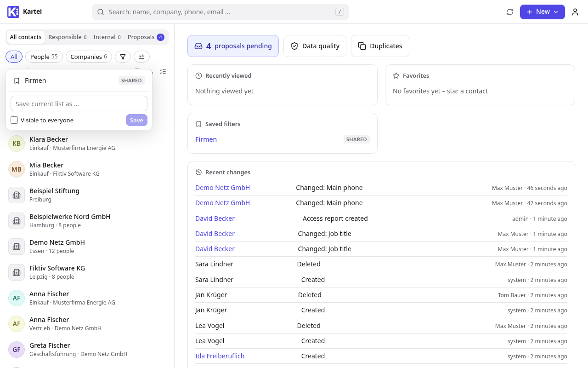

To use a saved filter, click it in the same menu or on the dashboard under **Saved filters**. On the dashboard, the pencil renames your own filters and the trash can deletes them after a confirmation (a shared filter disappears for everyone).

Maintainers can tick **Visible to everyone** when saving. The filter is then offered to all users and marked **Shared**.

### Exporting a list

The download button above the list exports exactly the contacts currently shown (including all filters), in the same order, as **Excel (XLSX)** or **CSV**. The file contains all fields you are allowed to see.

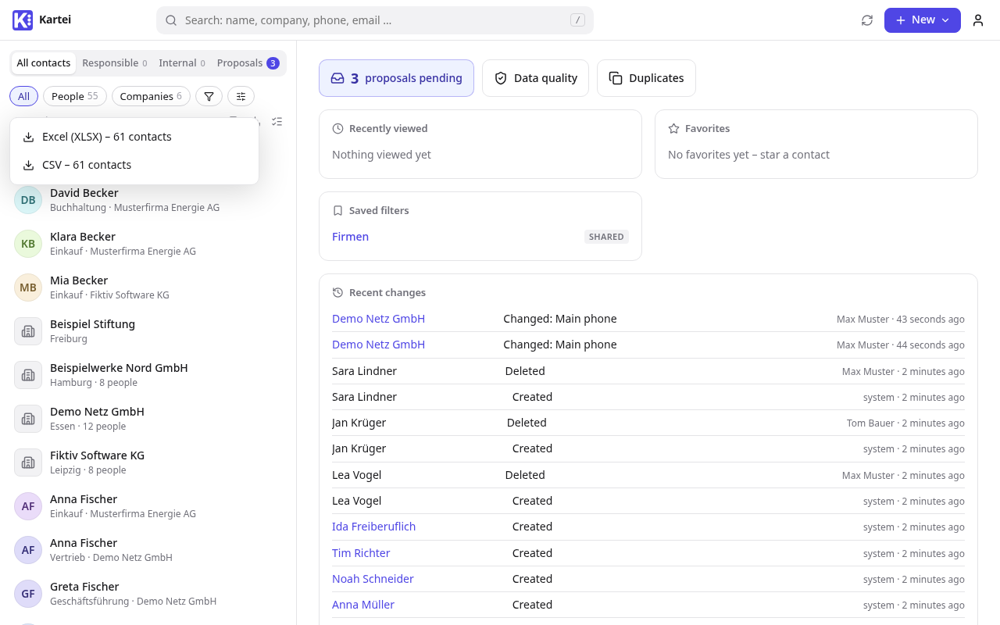

> Exports are recorded in the audit log. Handle exported files with care, as they may contain personal data.
{: .warn}

### Phone list (print or PDF)

The same menu offers **Phone list – print or PDF**: a printable list of the contacts currently shown (again with search, list and filters), e.g. all customers or one department's suppliers.

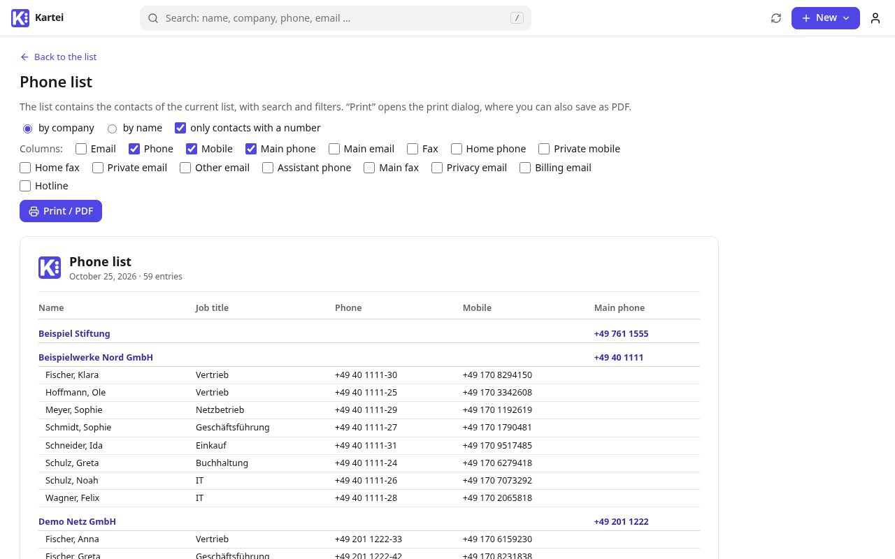

- **Order:** *by company* (each company with its own numbers, its persons below) or *by name* (A–Z, with the company in its own column).
- **only contacts with a number** leaves out contacts that have none of the chosen numbers.
- **Columns:** tick the phone and email fields to print. Kartei preselects the phone fields that someone in the list has filled in.
- **Print / PDF** opens your browser's print dialog. Choose your printer, or *Save as PDF* to get a file. Only the list itself is printed, on A4 with the column headings repeated on every page.

## The dashboard

When no contact is selected, the right side shows your dashboard:

- **… of my contacts to review:** your open reviews. A click switches the list to **To review**.
- **… proposals pending** (**Maintainers**): open proposals. A click switches the list to **Proposals**.
- **Data quality** and **Duplicates** (**Maintainers**): shortcuts to these pages.
- **Recently viewed:** the last contacts you opened.
- **Favorites:** contacts you marked with the star.
- **Saved filters:** your own filters and those shared with everyone.
- **Recent changes** (**Maintainers**): the latest changes by everyone. Hover over an entry to see the old and new values.

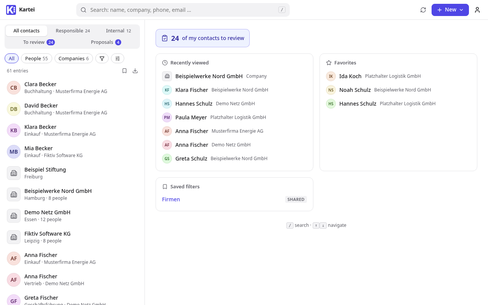

Recently viewed contacts and favorites are stored with your account, so you see the same ones on every device. Click the **Kartei** logo to return to the dashboard at any time. At the bottom, maintainers see a reminder of the keyboard shortcuts.

## Viewing a contact

Click a contact in the list to open it.

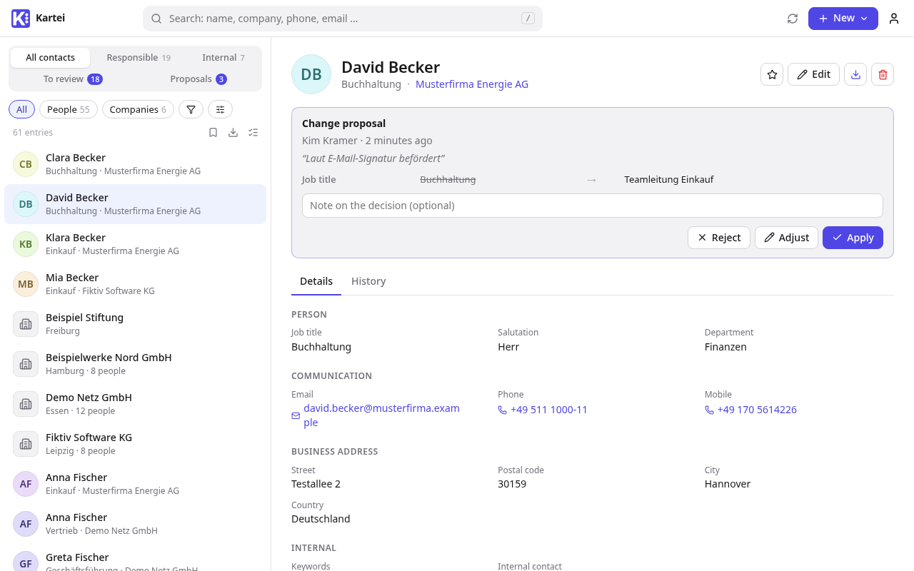

The header shows the name, job title and, for persons, a link to the company. The buttons on the right:

| Button | Does |
|---|---|
| Star | **Add to favorites** / **Remove from favorites** |
| **Edit** | opens the form (**Maintainers**, also <kbd>E</kbd>) |
| **Propose change** and trash can | propose a change or deletion (Read only) |
| Download | **Download vCard**, e.g. to import the contact into another program |
| Red trash can | **Delete**: moves the contact to the recycle bin (**Maintainers**) |

### Details

The **Details** tab lists all filled-in fields, grouped into sections. Empty fields are hidden.

- Phone numbers and email addresses are links: a click starts a call (e.g. via your softphone or on the phone) or opens a new email.
- The copy button next to a phone number or email address copies it to the clipboard.
- Websites open in a new tab.
- Fields with a small **i** have a help text; hover over the icon to read it.
- For linked persons (e.g. *Managing director*), the name is a link to that person.

At the bottom you see when and by whom the contact was last changed (*Changed … by …*; for automatic changes just *Changed …*) and last reviewed (*Reviewed … by …* or *Never reviewed*). Contacts imported from an earlier system also show their *Legacy ID*.

### Companies and their people

A company has an extra tab **People** listing everyone who works there. Maintainers can create a new employee directly with **Add person to this company**.

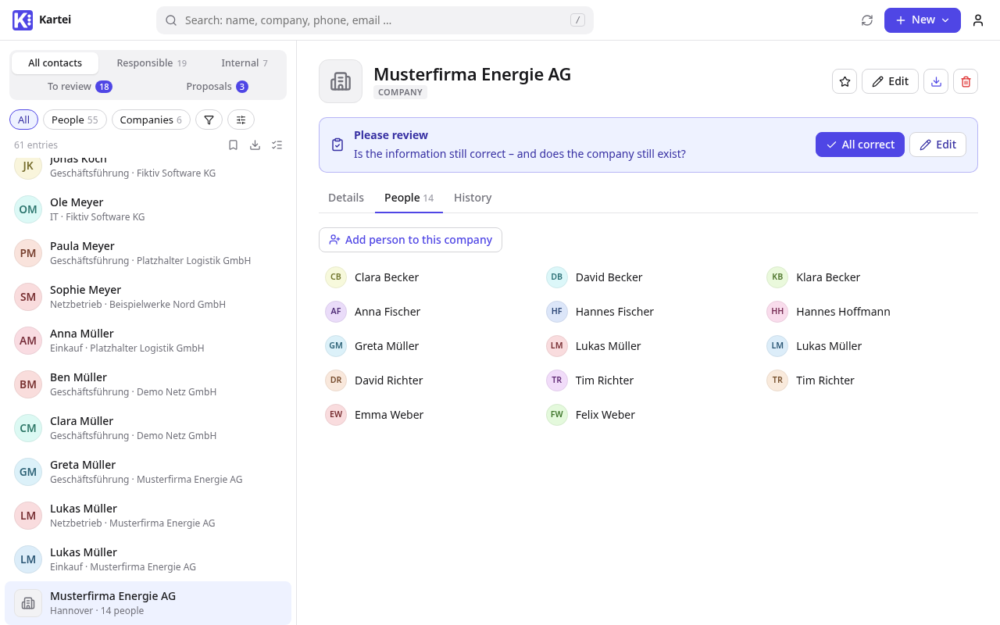

### History

The **History** tab shows every change to the contact: who changed what and when, with old and new values. Proposals, reviews, decisions and deletions are listed there too.

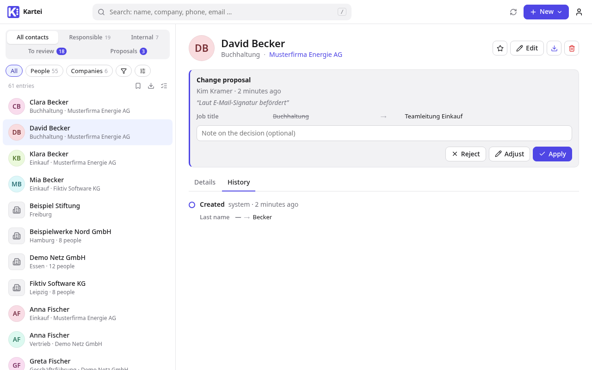

**Maintainers** can undo a change: **Restore** next to a change sets its fields back to the values before it. Kartei first shows what will change (*Job title: Assistant → Accounting*) and asks for confirmation. Fields that already have the old value again are left alone, and fields only admins may edit are skipped. The restore itself appears as a new change in the history, so it can be undone too.

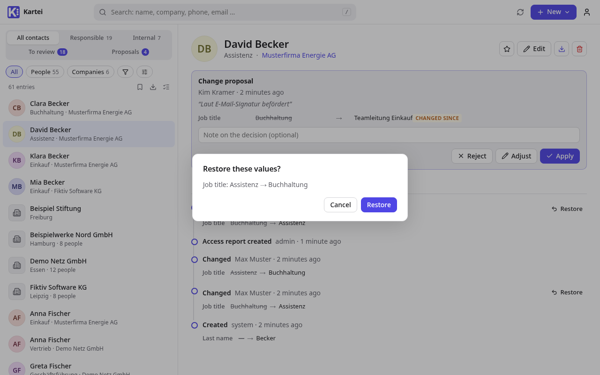

## Reviews

Contact details go out of date: people change jobs, companies move or close down. That is why Kartei regularly asks the colleague responsible for a contact (its *Internal contact*) to check it.

### How you are notified

When reviews are due, you get **one email** listing your contacts with direct links. If you don't get to them, Kartei may send a reminder later. Your administrator decides when reviews start and whether reminders are sent.

In Kartei, the dashboard shows **… of my contacts to review**, and the list switch shows **To review** with the number of open reviews.

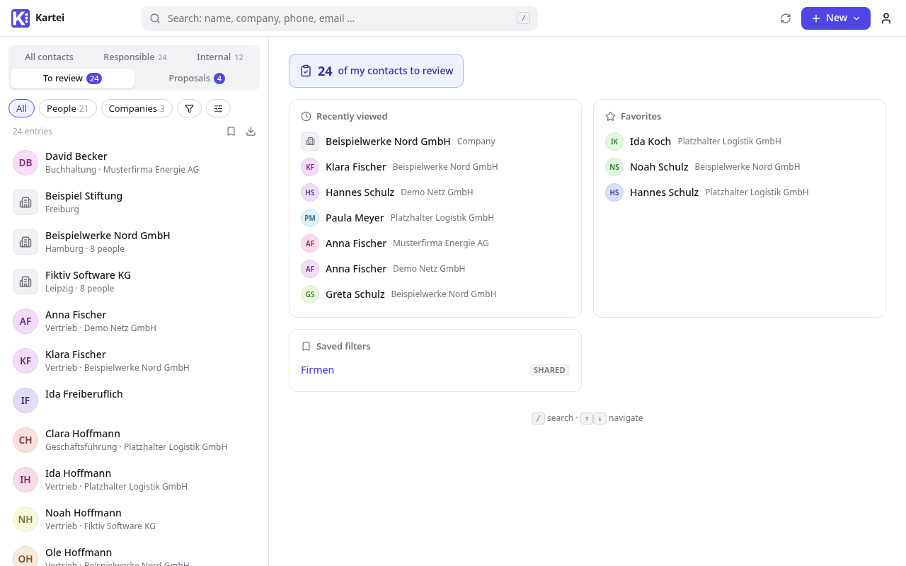

### Answering a review

Open a contact from the **To review** list. A blue **Please review** banner asks whether the information is still correct (for companies: also whether the company still exists).

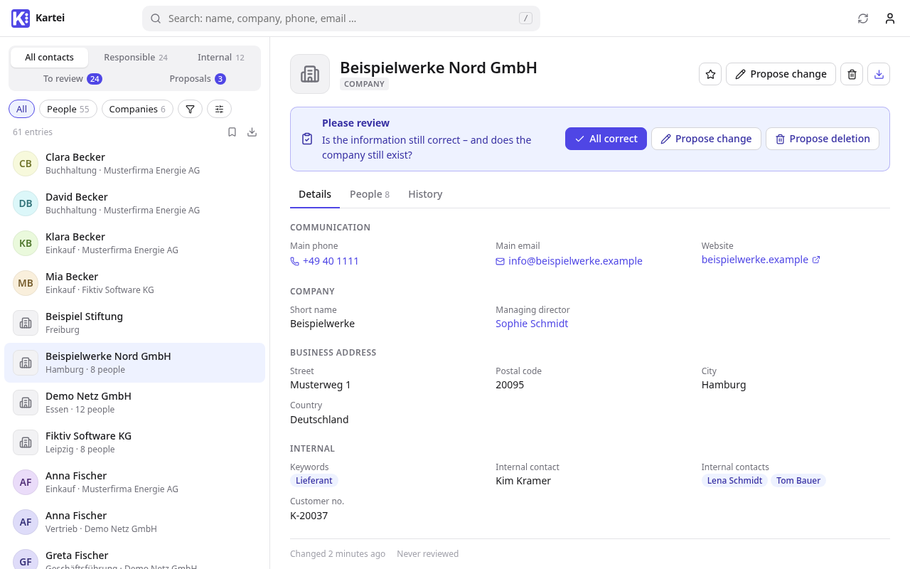

As a Read only user, choose one of three answers:

- **All correct:** everything is up to date. The review is done, and the contact shows *Reviewed … by* you.
- **Propose change:** something is wrong or missing. See [Proposing a change](#proposing-a-change).
- **Propose deletion:** the contact should go. See [Proposing a deletion](#proposing-a-deletion).

Sending a proposal also completes your review; you don't need to click **All correct** afterwards. The contact then disappears from your **To review** list.

**Maintainers** see **All correct** and **Edit** in the banner instead. Correct the contact directly; saving a change also completes your review. If the contact should be deleted, delete it (see [Deleting and restoring](#deleting-and-restoring)).

### Proposing a change

Read only users can propose changes at any time, not just during a review.

1. Open the contact and click **Propose change** (in the header or in the review banner).
2. Correct the fields in the form. The note at the top reminds you: *Your changes are not saved directly; they go to a maintainer for approval.*
3. Optionally explain the change under **Comment (optional)**, e.g. "according to their email signature".
4. Click **Send proposal**.

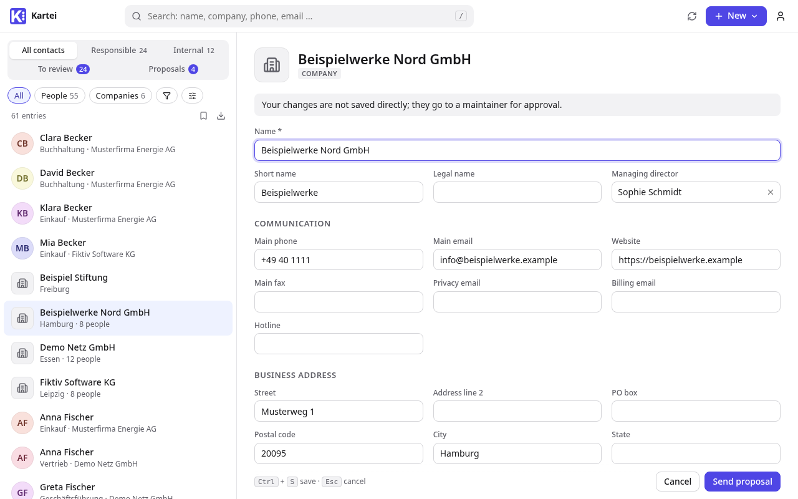

A maintainer then applies, adjusts or rejects your proposal. You can't change the contact's picture through a proposal.

### Proposing a deletion

1. Open the contact and click **Propose deletion** in the review banner, or the trash can button in the header (**Propose deletion**).
2. Choose a reason:
   - **Left the company** (persons only): the person no longer works there.
   - **Company no longer exists**: the company has closed. This always applies to the whole company: if accepted, the company **and all its persons** are deleted. Kartei shows how many persons are affected. You can choose this reason on a company or on any of its persons.
   - **Other reason**: describe the reason in the comment field; here the comment is required.
3. Click **Send proposal**.

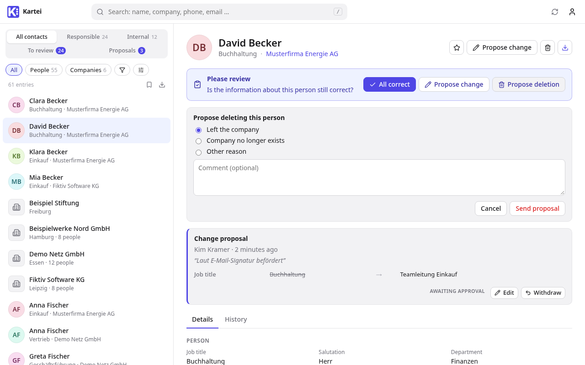

For a company, only **Company no longer exists** and **Other reason** are offered:

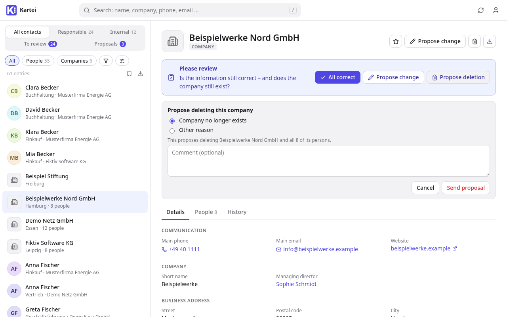

> A deletion proposal is only carried out after a maintainer applies it. Until then the contact stays visible to everyone.
{: .warn}

If someone has already reported that a company no longer exists, Kartei tells you (*This was already reported for this company – it is awaiting approval.*) and your review is still counted as done.

### Proposing a new contact {#proposing-a-new-contact}

With the role *Read only* you can also propose new persons and companies, e.g. a new colleague at a customer.

1. Click **New** at the top right and choose **Propose new person** or **Propose new company** (or press <kbd>N</kbd> / <kbd>Shift</kbd>+<kbd>N</kbd>).
2. Fill in the form as far as you know the details. Required fields are marked with **\***; a hint at the top reminds you: *The contact is not created directly; it goes to a maintainer for approval.*
3. Optionally explain where the information comes from under **Comment (optional)**.
4. Click **Send proposal**.

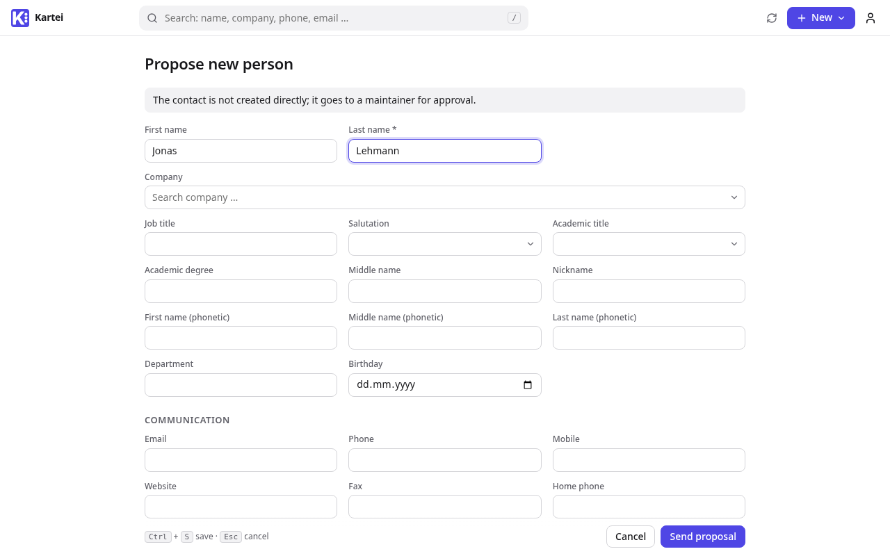

Kartei then shows your proposal on its own page, and it appears in the list **Proposals** with the badge **new**. Until a maintainer decides, you can **Edit** or **Withdraw** it there. Images can be added by the maintainer after the contact has been created.

### Editing or withdrawing your proposal

As long as no maintainer has decided, your proposal is shown on the contact with the badge **Awaiting approval**. You find all your pending proposals in the list **Proposals**. On the contact you can:

- **Edit:** change your proposed values or comment (change proposals only), then **Send proposal** again.
- **Withdraw:** take the proposal back completely (after a confirmation).

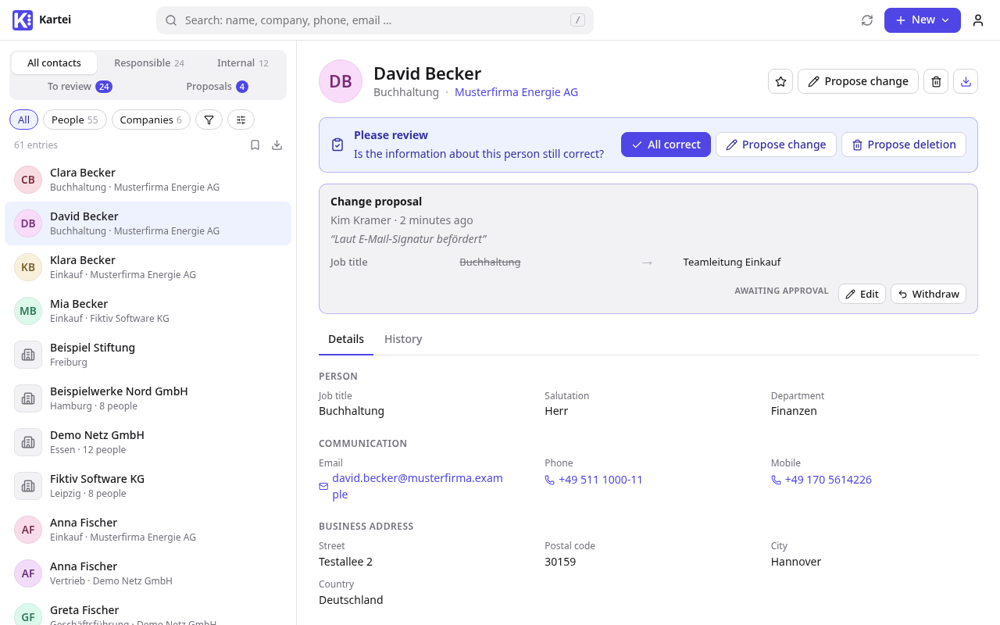

Once a maintainer has decided, the proposal disappears from the list; the decision is recorded in the contact's **History**.

## Creating and editing contacts

**Maintainers.** Read only users don't see the **Edit** button, and **New** only proposes a contact; they [propose](#proposing-a-new-contact) changes and new contacts instead.

### Creating a person or company

1. Click **New** at the top right and choose **Person** or **Company** (or press <kbd>N</kbd> for a person, <kbd>Shift</kbd>+<kbd>N</kbd> for a company).
2. Fill in the fields. Required fields are marked with **\***: a person needs at least a **Last name**, a company a **Name**.
3. Click **Create** (or press <kbd>Ctrl</kbd>+<kbd>S</kbd>).

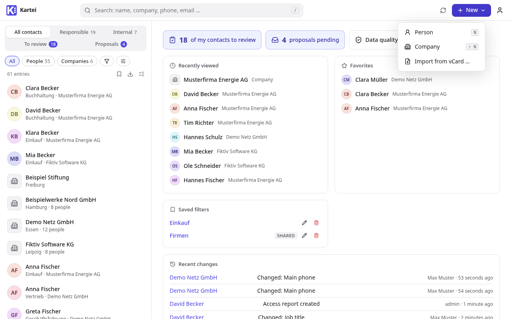

For a person, choose the **Company** by typing part of its name (*Search company …*). To create a new employee of a company directly, open the company, go to the **People** tab and click **Add person to this company**; the company is then filled in already.

### Importing from a vCard {#importing-from-a-vcard}

Contacts that arrive as a vCard (`.vcf`), e.g. attached to an email, exported from a phone or from Outlook, don't have to be typed in:

1. Click **New** at the top right and choose **Import from vCard …**.
2. Drop the `.vcf` file onto the box or click it to choose one (several files or a file with several cards are fine). Alternatively, paste the vCard text.
3. Each card opens as a **filled-in new-contact form** (*Contact 1 of 3*): names, company, job title, phone numbers, email addresses, address, birthday and photo go into the fields that have the matching vCard assignment. The company is linked if Kartei already knows it, and the usual duplicate hint and *Copy details from …* panel appear.
4. Check and complete the details and click **Create**, or **Skip** the card.

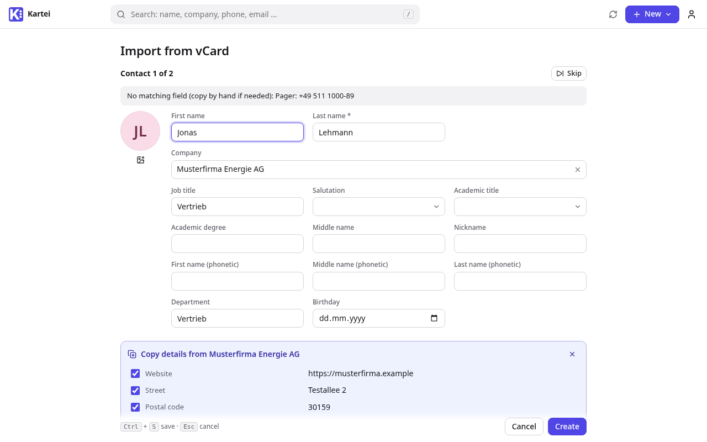

Values without a matching field (e.g. a pager number) are listed above the form so you can copy them by hand. With the role *Read only*, the cards become [proposals](#proposing-a-new-contact) instead.

### Copying details from the company

As soon as a person has a company, Kartei offers to take over the company's details, e.g. website, address or internal contact: **Copy details from …**.

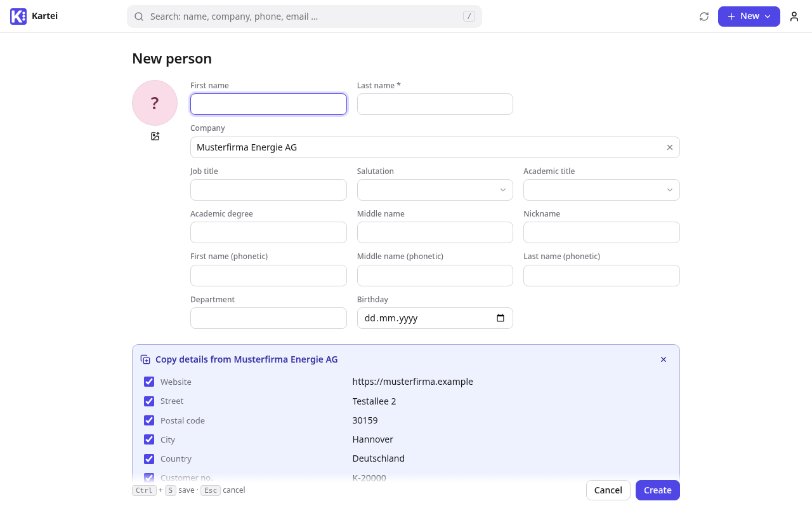

1. Untick the values you don't want. Values marked **overwrites** would replace something already entered; these start unticked.
2. Click **Copy …** (the button shows how many values are copied).

**Undo** reverts the copy. The **×** closes the panel without copying anything.

### Duplicate warning

While you type, Kartei checks whether a similar contact already exists: same email address, same phone number or same name (for persons: in the same company). If so, a yellow banner shows **Possible duplicate:** with links to up to three matches. The links open in a new tab, so your input is not lost. Check them before you create a second entry.

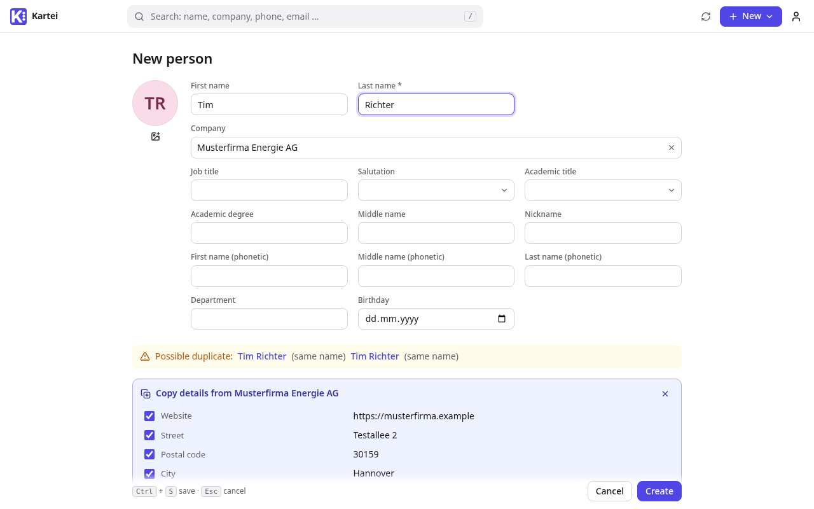

### Editing a contact

Open the contact and click **Edit** (or press <kbd>E</kbd>). Change the fields and click **Save** (<kbd>Ctrl</kbd>+<kbd>S</kbd>). **Cancel** (<kbd>Esc</kbd>) leaves the form; if you have unsaved changes, Kartei asks *Discard unsaved changes?* with **Keep editing** or **Discard**.

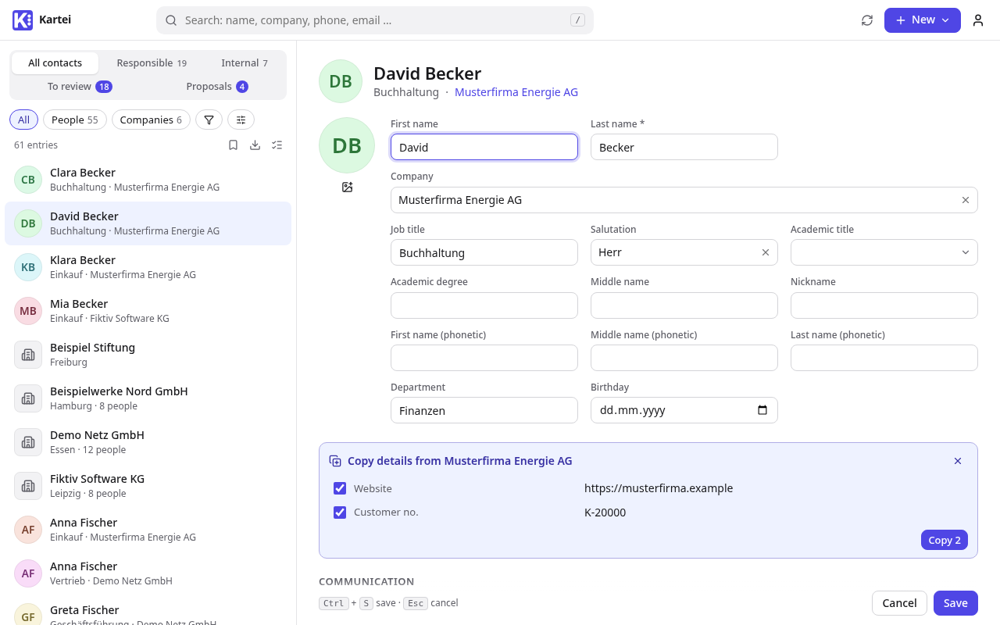

- **Picture:** click the picture icon below the avatar to **Upload image** (PNG, JPEG or WebP; it is scaled down automatically). When editing an existing contact, the picture is saved immediately. **Remove image** asks first and then deletes it right away, too.
- **Help texts** appear below some fields and explain what belongs there.
- **Greyed-out fields** may only be changed by administrators.
- **Phone numbers** may contain digits, spaces and `+ ( ) / -`. Depending on your administrator's settings, national numbers are saved in international form, e.g. `0511 1000-12` becomes `+49 511 1000-12`.

### When saving fails

Kartei checks your input while you type and when you leave a field: invalid fields are marked in red with the reason below, e.g. *Required*, *Not a valid email address* or *Does not match the required format*. When you save, all fields are checked again (also on the server); if something is still wrong, Kartei shows *Please check the highlighted fields*. Correct the marked fields and save again.

If someone else saved the same contact while you were editing, Kartei shows *… changed this contact in the meantime.* You have two choices:

- **Show their version:** discards your input and shows the contact as the other person saved it. Then edit again if needed.
- **Save my changes anyway:** saves the fields *you* changed on top of the other version. Fields you didn't touch keep the other person's values.

> If you both changed the same field, your value wins. If unsure, choose **Show their version** and compare first.
{: .tip}

### Choice fields, users and linked persons

- **Choice fields** (e.g. *Salutation*, *Keywords*): type to search the options. Some fields allow new values; type the new value and choose **Add "…"**. It then becomes an option for everyone.
- **User fields** (e.g. *Internal contact*, *Internal contacts*): pick colleagues by name or username (administrators are not offered). The *Internal contact* is the person responsible for the contact and gets its reviews; the list **Responsible** is based on it. *Internal contacts* can hold several colleagues; the list **Internal** is based on it.
- **Linked persons** (e.g. *Managing director* of a company): choose one of the company's persons. If the field allows free text, you can also type a name and choose **Use "…" as text**.

### Company changes and their employees

Persons are linked to their company, so a renamed company shows its new name everywhere at once. For other changes, e.g. a new address or new main phone number, Kartei asks after saving the company: **Apply to … employees as well?**

- **Copied fields** (address, website, hotline, …): employees who still have the company's old value get the new one.
- **Phone numbers:** employee numbers that begin with the company's old number get the new number and keep their extension.

Each suggested change has its own checkbox. Untick the ones that shouldn't change, then click **Apply … changes**, or **Don't apply** to leave the employees unchanged.

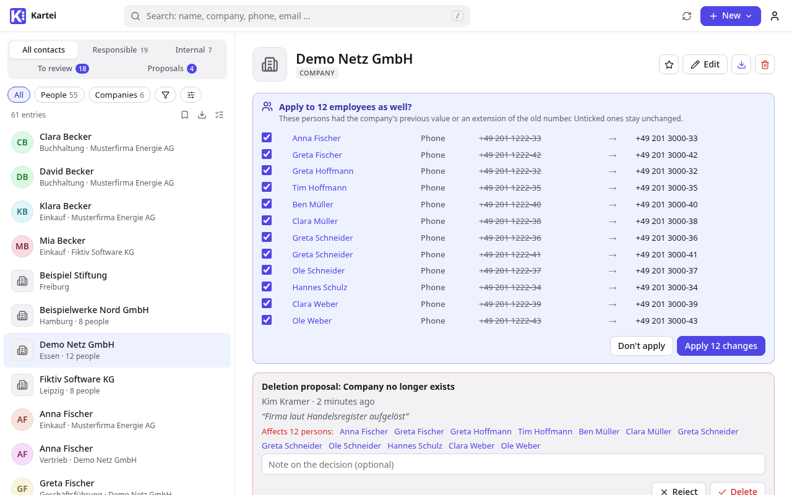

## Deleting and restoring

**Maintainers.**

### Deleting a contact

Open the contact and click the red trash can (**Delete**). Kartei asks **Move to the recycle bin?**; confirm with **Move to recycle bin** (or <kbd>Enter</kbd>), or keep the contact with **Cancel** (or <kbd>Esc</kbd>). The contact then moves to the recycle bin, and the message at the bottom offers **Undo** for a few seconds.

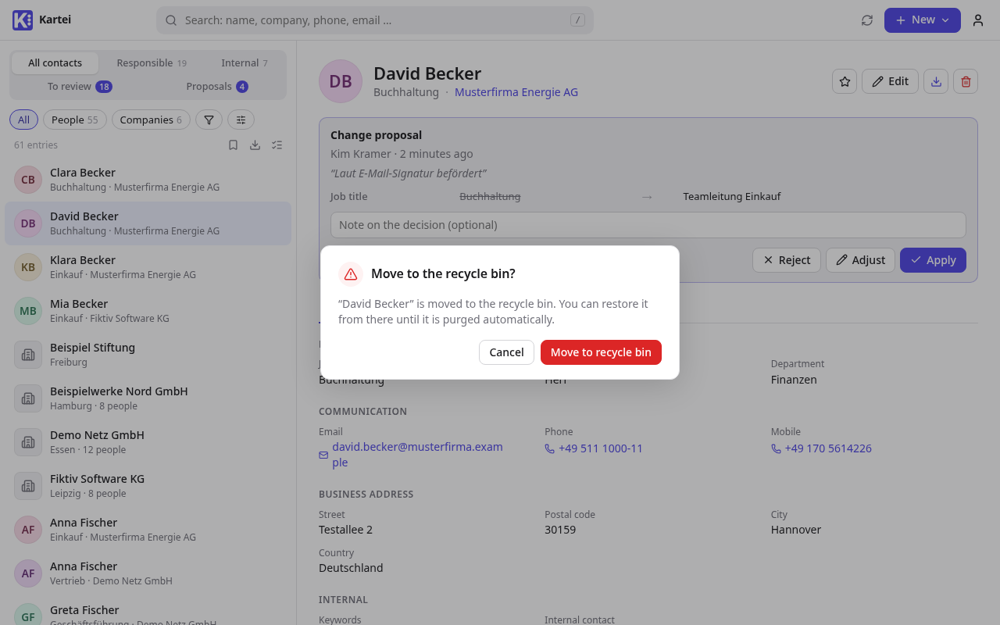

> Every action that deletes something asks first in the same kind of dialog: deleting contacts, deleting permanently from the recycle bin, removing an image, deleting a saved filter and withdrawing a proposal. The dialog says what happens to the data. <kbd>Esc</kbd> or a click next to the dialog cancels.
{: .tip}

**Deleting a company:** the dialog says how many persons belong to the company and offers **Also move its … persons to the recycle bin**. The box is **not ticked** by default:

- Leave it unticked to delete only the company. Its persons stay in the directory and keep the company name, but the company itself is in the recycle bin.
- Tick it if the company has closed and its staff should go too. The company and all its persons move to the recycle bin together; each person's history notes *Deleted with company*.

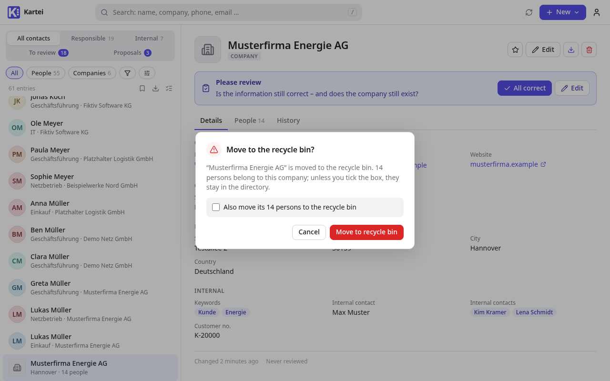

**Undo** in the message brings back the company together with the persons deleted with it. In the recycle bin, they can also be restored one by one.

### The recycle bin

Open **Recycle bin** in the user menu. It lists deleted contacts with the time and the user who deleted them. **Restore** brings a contact back with all its data and history.

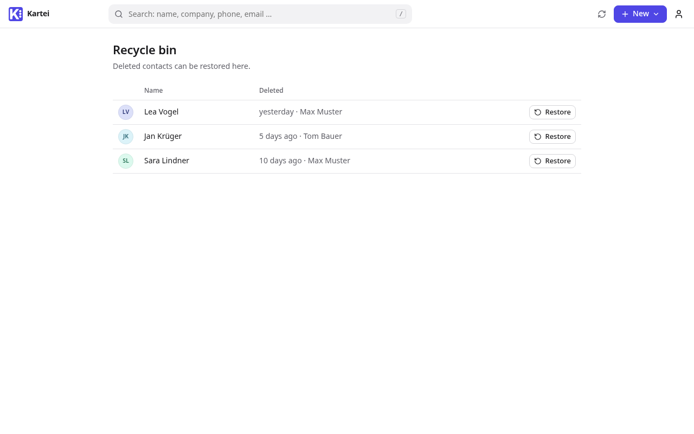

Your administrator decides how long deleted contacts stay in the recycle bin; after that they are deleted permanently. Only administrators can delete a contact permanently by hand (trash can in the recycle bin, **Delete permanently**). The dialog warns that this cannot be undone; for a company it also says how many persons lose their company.

## Editing several contacts

**Maintainers.** Use this to change many contacts at once, e.g. to add a keyword or hand over contacts to a new colleague.

1. Narrow down the list with search, list and filters (including the advanced filter).
2. Click the selection button above the list (**Edit several**). Checkboxes appear.
3. Click contacts to select them. <kbd>Shift</kbd>+click selects a range. **Select all …** selects the whole list, **None** clears the selection.
4. Choose an **Action** and, if needed, the **Field** and the value.
5. Click **Apply to …**.

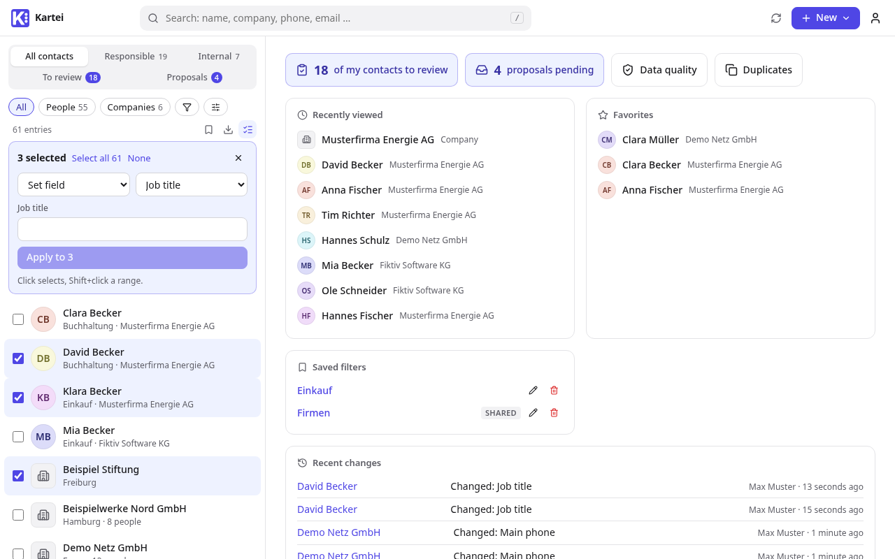

| Action | Does |
|---|---|
| **Set field** | sets the field to the value for all selected contacts |
| **Clear field** | empties the field |
| **Add values** | adds values to a multi-choice field (e.g. *Keywords*) and keeps the existing ones |
| **Remove values** | removes values from a multi-choice field |
| **Set responsible** | sets the responsible user (*Internal contact*) |
| **Move to recycle bin** | deletes the selected contacts after a confirmation (**Move … contacts to the recycle bin?**). If companies are selected, the dialog offers **Also move their … persons to the recycle bin** for persons of these companies that are not selected (not ticked by default). |

Contacts that could not be changed (e.g. because a required field would become empty) stay selected, and a message lists them with the reason. The changes appear in each contact's history. Close the selection with **×** (**End selection**).

## Deciding proposals

**Maintainers.** When colleagues propose changes, deletions or new contacts, the dashboard shows **… proposals pending** and the list **Proposals** appears. Open a contact from that list to see the proposal above the details.

### Change proposals

The proposal shows who sent it and when, the comment, and a table with each field's current and proposed value.

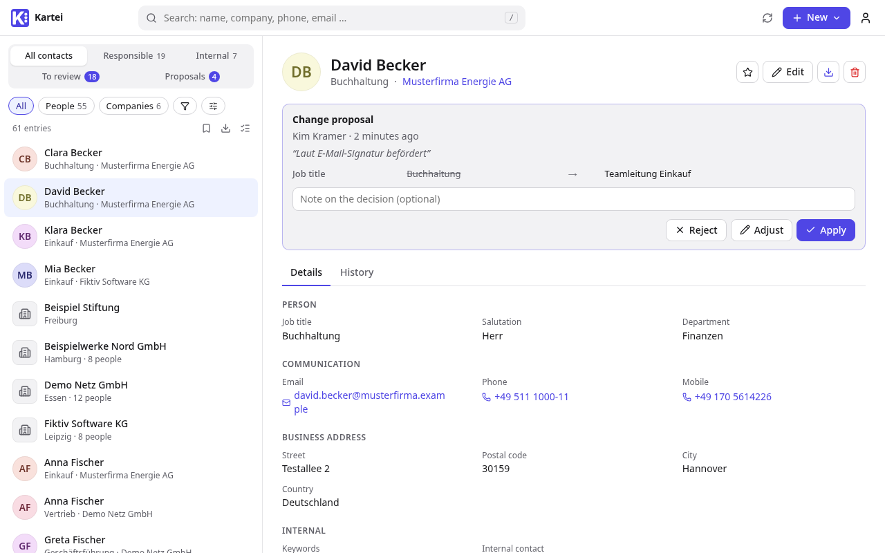

- **Apply:** carries out the change as proposed.
- **Adjust:** opens the form with the proposed values filled in. Correct what's needed and click **Apply**; your values are saved and the proposal counts as accepted.
- **Reject:** declines the proposal; the contact stays unchanged.

Optionally write a **Note on the decision (optional)** before you click; it is stored in the history.

If the contact was changed after the proposal was sent, the affected value is marked **changed since**. Applying the proposal would overwrite that newer value, so check it first, and use **Adjust** if in doubt.

### Deletion proposals

A deletion proposal shows the reason and the comment. **Delete** moves the contact to the recycle bin, **Reject** keeps it.

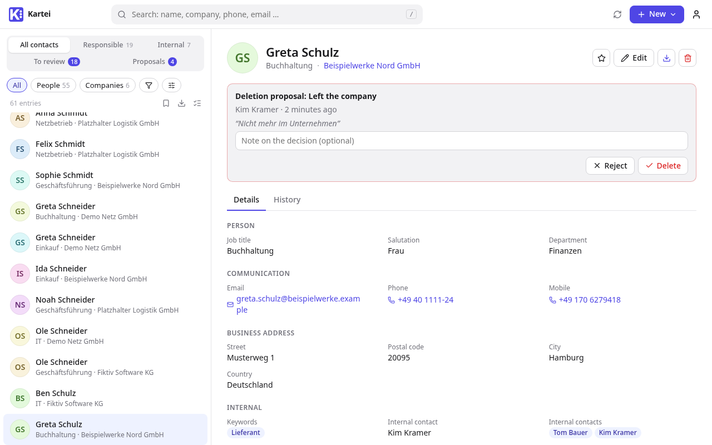

For **Company no longer exists**, the proposal is shown on the company and lists the affected persons (*Affects … persons:*). **Delete** moves the company **and all its persons** to the recycle bin.

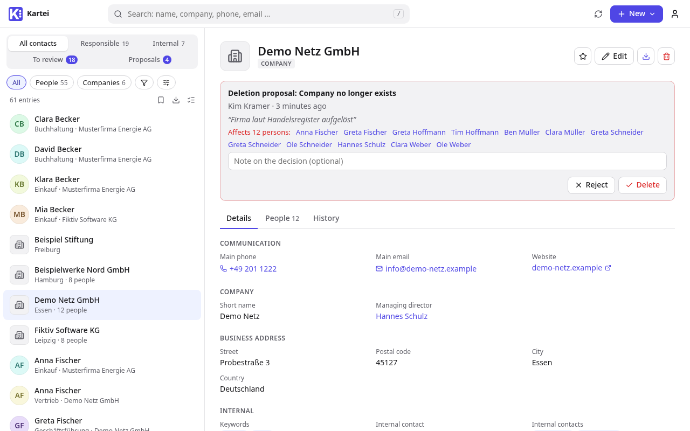

The persons of such a company show a note (*… was reported as no longer existing.*) with a link **Open company**, so you can decide there.

### Proposed new contacts

Proposed new persons and companies don't exist yet, so they are listed at the top of the list **Proposals**, marked **new**. Click one to open its page: it shows who proposed it, the comment and all proposed values.

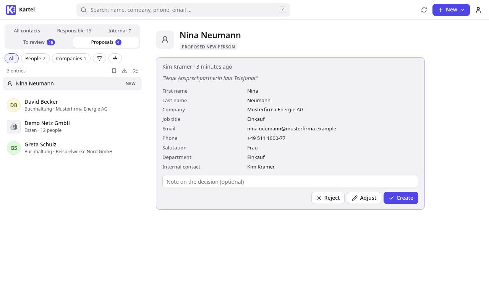

- **Create:** creates the contact with the proposed values and opens it.
- **Adjust:** opens the form with the proposed values filled in, e.g. to complete the company or the internal contact. **Create** saves your values and accepts the proposal.
- **Reject:** declines the proposal; no contact is created.

Before creating, check that the contact doesn't exist yet: the form shows the usual hint on possible duplicates.

> Every decision, including the note, is recorded in the contact's history. Deleted contacts can be restored from the recycle bin.
{: .tip}

## Data quality

**Maintainers.** Open **Data quality** from the dashboard or the user menu. It shows how many contacts need attention in each area; click an area to see the contacts and open them.

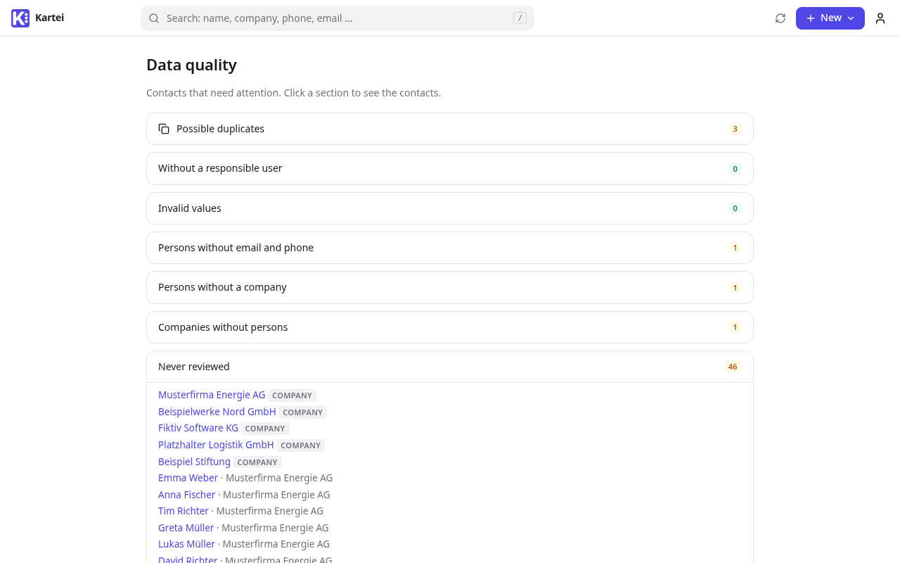

| Area | Means |
|---|---|
| **Possible duplicates** | leads to the duplicates page |
| **Without a responsible user** | no *Internal contact*; these contacts can't be reviewed |
| **Invalid values** | stored values that don't meet the field's rules, e.g. after an import; the reason is shown |
| **Persons without email and phone** | no way to reach the person |
| **Persons without a company** | persons not linked to any company |
| **Companies without persons** | companies with no employees in Kartei |
| **Never reviewed** | contacts that have never been checked |
| **Review overdue** | the last review is older than the review interval |

## Duplicates and merging

**Maintainers.** Open **Duplicates** from the dashboard, the user menu or **Data quality**. Kartei lists pairs of contacts of the same kind that share an email address, a phone number or the name (persons: within the same company). The **Match** column shows why.

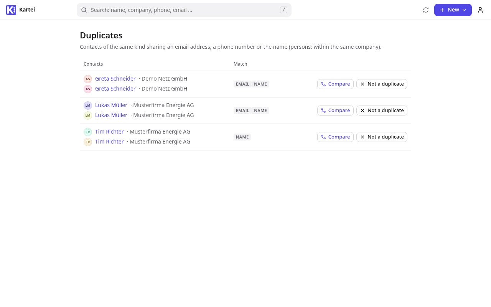

- **Not a duplicate:** the two contacts really are different. The pair is hidden permanently.
- **Compare:** opens the merge screen.

### Merging two contacts

1. At the top, choose which contact **stays**; the other one **is merged**. Kartei preselects the more recently changed one.
2. For each field, choose which value to keep. For multi-choice fields such as *Keywords* you can choose **Both**.
3. Click **Merge**.

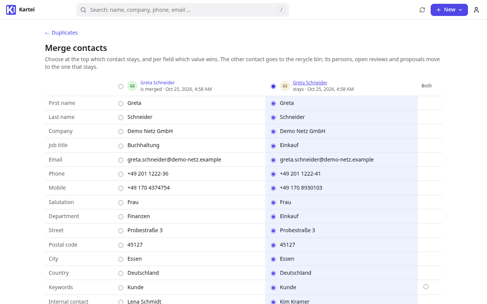

The remaining contact keeps both histories. The employees, open reviews and proposals of the merged contact move to it. The merged contact goes to the recycle bin, and links to it lead to the remaining contact.

## Keyboard shortcuts

| Key | Action |
|---|---|
| <kbd>/</kbd> | jump to the search |
| <kbd>↑</kbd> <kbd>↓</kbd> | move through the results |
| <kbd>Enter</kbd> | in the search: open the first or selected result |
| <kbd>Esc</kbd> | in the search: clear it, then leave it; in a form: cancel |
| <kbd>E</kbd> | edit the open contact (maintainers) |
| <kbd>N</kbd> / <kbd>Shift</kbd>+<kbd>N</kbd> | new person / new company (read only: propose one) |
| <kbd>Ctrl</kbd>+<kbd>S</kbd> | save the form (on a Mac also <kbd>Cmd</kbd>+<kbd>S</kbd>) |

The shortcuts don't work while you are typing in a field (except <kbd>Ctrl</kbd>+<kbd>S</kbd> and <kbd>Esc</kbd> in forms, and the arrow keys and <kbd>Enter</kbd> in the search).

## Contacts on your phone

If your organization uses it, Kartei contacts can also appear in your phone's address book, so incoming calls show the caller's name. Your IT department or administrator sets this up:

- **Outlook app (iPhone and Android):** if your organization uses Microsoft 365, Kartei puts the contacts into a folder in your mailbox. In the Outlook app, turn on *Save contacts* for your account (*Settings* → account → *Save contacts*) so they are stored on the phone.
- **CardDAV account (iPhone):** an alternative, e.g. for phones without a personal mailbox. Your administrator gives you the server address and login. The contacts appear as a separate address book and are read-only on the phone.

Only fields visible to everyone are synced. Changes are made in Kartei, not on the phone; they reach the phone at the next sync.
